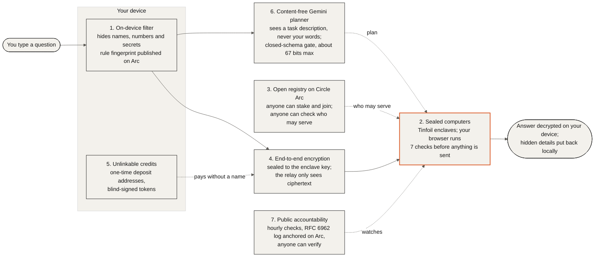
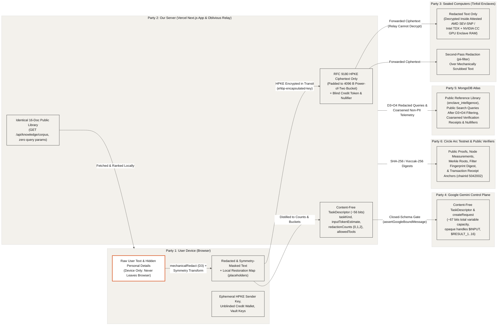
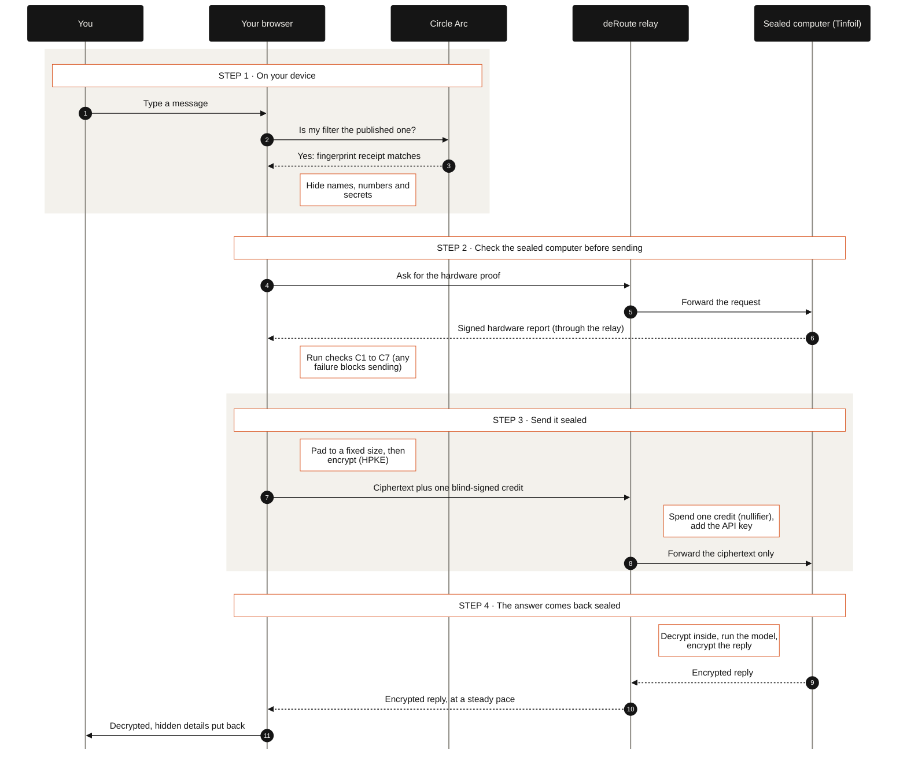

# deRoute: Hardware-Attested Private AI Router


**deRoute** is a private AI router and split-knowledge verification system. It lets you chat with frontier AI models and run multi-step document or code reviews without the model host, Google, MongoDB, or deRoute reading your private words or personal details.

- **Live deployment**: https://drouter-demo.vercel.app
- **Source repository**: https://github.com/thepigdestroyer/drouter
- **Deployment and operations runbook**: [docs/DEPLOY.md](docs/DEPLOY.md)
- **Hackathon submission and demo script**: [docs/SUBMISSION.md](docs/SUBMISSION.md)
- **Google Cloud Confidential Space workload**: [docs/confidential-space.md](docs/confidential-space.md) and [core/README.md](core/README.md)
- **Transparency log restart note (25 October 2026)**: [docs/transparency-log-restart.md](docs/transparency-log-restart.md)
- **Architecture in pictures**: [docs/ARCHITECTURE.md](docs/ARCHITECTURE.md)
- **Security policy**: [SECURITY.md](SECURITY.md)

*Naming note:* The product is called **deRoute**. Internal cryptographic domain labels (`drouter/v1/...`), HTTP headers (`X-DRouter-*`), environment variable names, the MongoDB `drouter` database, file and script names (`scripts/drouter-cli.mjs`, `DRouterRegistry.sol`), and the production URL (`https://drouter-demo.vercel.app`) stay unchanged for compatibility.

---

## How it works at a glance

Seven building blocks work together. Your words are filtered on your device, sealed so only a verified sealed computer can read them, and paid for without a name. Gemini plans from a description that contains none of your words, and everything that can be checked is checked in public. The full visual guide, with ten detailed diagrams, is in **[docs/ARCHITECTURE.md](docs/ARCHITECTURE.md)**.



### Who can see what



### The life of one chat message



---

## 1. What deRoute Does (Plain Language)

### For a Non-Technical User

When you paste a sensitive document, clinical pipeline, or piece of code into a normal AI website, every server along the way can read your words, names, emails, dates, and keys.

deRoute changes that before your message ever leaves your browser:

1. **Removes personal details on your device first**: Your browser runs a built-in deterministic filter that replaces names, email addresses, phone numbers, street addresses, dates, account numbers, API keys, and your own `"Always hide"` terms with numbered placeholders (`[EMAIL_1]`, `[SECRET_1]`), and shifts dates and currency figures with reversible math. Your browser also checks that the filter rules match the public fingerprint anchored on Circle Arc Testnet (`tx 0x09055dc1b5d6a79de9d96824ee76213b2c238a8bfd744ab143405d30db1fe730`), blocking send if they do not match.
2. **Runs a second filter inside a sealed computer**: After the on-device filter finishes, your browser sends the already-filtered text over an end-to-end encrypted link to a dedicated Tinfoil `pii-filter` sealed computer (`https://pii-filter.tinfoil.sh`) to catch any remaining unstructured personal details. If that sealed computer is unreachable, deRoute continues with the on-device filter and tells you plainly.
3. **Checks the digital seal and locks your message end to end**: Before sending a chat message or task, your browser verifies the hardware seal on the remote Tinfoil sealed computer (an AMD SEV-SNP router and an Intel TDX or AMD SEV-SNP model enclave with 8x NVIDIA Confidential Computing GPUs), pads your message to a standard size, and encrypts it on your device so only that sealed computer can open it. Our relay server forwards the locked envelope and attaches the service API key, but cannot read your words.
4. **Plans multi-step tasks without showing Google your text**: On the `/argon` Agent page, Google Gemini (`gemini-4-argon`) plans the verification and execution steps using only a content-free checklist (`TaskDescriptor`) that contains no words from your task. Every outbound message to Google passes a closed-schema egress gate with a hard mathematical bound on how many bits it can carry, and produces a verifiable egress receipt.
5. **Downloads the whole reference library so the database learns nothing**: When an agent run needs reference material about confidential computing hardware or advisories, your browser downloads the entire 16-document public corpus (`GET /api/knowledge/corpus`) in one identical, cacheable file and ranks it locally in browser memory. Because every user downloads the exact same file with zero query parameters, MongoDB Atlas learns nothing about what you are looking up.
6. **Restores your original names on your screen**: When the sealed computer streams its answer back, your browser decrypts it and restores the original names, dates, and numbers locally on your device.

### Example Persona (Fictional)

The default workflow in the codebase (`DEMO_PERSONA` and `DEFAULT_TASK_PROMPT` in `src/lib/gemini/shared.ts`) uses **Example: a fictional hospital data scientist** working on clinical trial statistics (`Phase II trial survival analysis: protocol, de-identified case notes, and R analysis code`). The sample prompt reviews study pipeline `ONC-2041` for cohort `COHORT-2026-08-14` with a grant budget of `£125,000.00`, fictional contact `dana.reyes@example.org`, and synthetic test credential `sk-test-4f9a2c7e1b8d6a3f5e0c` without exposing any personal details or keys to cloud providers. No real personal names, emails, or account identifiers are used anywhere in the repository.

---

## 2. The Privacy Design (Plain First, Then Technical)

### 2.1 On-Device Deterministic Filter and Arc-Anchored Fingerprint

- **Plain**: Your browser runs a deterministic rule-based filter (`mechanicalRedact`) that strips personal details and secrets on your device before anything is sent over the network. All of its rules live in a single auditable ruleset (`MECHANICAL_RULESET` v`1.0.1`). The SHA-256 fingerprint of that ruleset is anchored on Circle Arc Testnet in transaction `0x09055dc1b5d6a79de9d96824ee76213b2c238a8bfd744ab143405d30db1fe730`. Every time you load the chat or agent page, your browser recomputes the fingerprint of the code it is actually running and checks it against the published anchor (`Personal-detail filter v1.0.1: matches the published version`). If they ever differ, sending is blocked with an orange warning.
- **Technical**:
  - `src/lib/privacy/mechanical-ruleset.ts` exports `MECHANICAL_RULESET` (`version: "1.0.1"`), defining all regex sources and flags, Unicode zero-width and homoglyph normalization tables, Shannon entropy thresholds, Luhn and IBAN Mod-97 parameters, and allowlisted technical word lists. `src/lib/privacy/mechanical.ts` reads rules exclusively from `MECHANICAL_RULESET`.
  - `rulesetFingerprint(MECHANICAL_RULESET)` (`src/lib/privacy/fingerprint.ts`) computes `0x` + lowercase `sha256(canonicalJson(MECHANICAL_RULESET))`:
    - **Version**: `1.0.1`
    - **Ruleset SHA-256 fingerprint**: `0x0928121dfa0558ab8e59af0298aa76c5b9a3674012d2ff162b66df79bba20f28`
    - **Arc receipt payload**: `deroute-filter:1.0.1:0x0928121dfa0558ab8e59af0298aa76c5b9a3674012d2ff162b66df79bba20f28`
    - **Arc receipt keccak256 hash**: `0x20364c27cddeb0eb5ba81f8e25d49d23b50174f1899d7f8152f729c67a4789fb`
    - **Arc Testnet anchor transaction (`chainId 5042002`)**: `0x09055dc1b5d6a79de9d96824ee76213b2c238a8bfd744ab143405d30db1fe730` (committed in `src/lib/privacy/published-fingerprint.json`, published via `scripts/publish-filter-fingerprint.mjs`).
  - Alongside `mechanicalRedact`, the browser pipeline (`src/lib/pipeline/`, `src/lib/symmetry/homomorphism.ts`, `src/lib/stylometry/`) applies reversible symmetry masking (`T^-1(f(T(x))) = f(x)` over dates, currency figures, and named entities), stylometric normalization, and 4,096-byte power-of-two RFC 8259 JSON bucket padding (`padJsonPayloadToBucket` in `src/lib/relay.ts`).

### 2.2 Second Filtering Pass Inside a Tinfoil Sealed Computer

- **Plain**: After the on-device mechanical filter removes structured identifiers, your browser sends the mechanically redacted text through an encrypted channel to Tinfoil's attested `pii-filter` sealed computer for a second pass that catches unstructured names or context. If the `pii-filter` enclave is unavailable, deRoute falls back to the on-device mechanical filter and symmetry masking and reports that fallback honestly.
- **Technical**: `attestedPiiFilter()` (`src/lib/privacy/attested-filter.ts`) opens a verified Tinfoil `SecureClient` against `https://pii-filter.tinfoil.sh` (`configRepo: "tinfoilsh/confidential-pii-cpu"`) routed via `/api/relay/v1/` with `X-Tinfoil-Model: pii-filter` and 4,096-byte bucket padding. Any additional spans returned by `pii-filter` are mapped into reversible `[ATTESTED_PII_N]` placeholders in `runBrowserRedactionPipeline()` (`src/lib/agent-client/index.ts`), and `taskDescriptor.verification.attestedPiiFilterVerified` records the real verification outcome.

### 2.3 End-to-End Encrypted Chat to Tinfoil Enclaves Through an Oblivious Relay

- **Plain**: Your browser verifies the hardware attestation of Tinfoil's router and model enclaves before encrypting your prompt on your device. The encrypted request travels through `/api/relay/v1/*`, which attaches the server's `TINFOIL_API_KEY` so no API key is shipped to the browser, but the relay only ever sees encrypted bytes padded to 4,096-byte buckets.
- **Technical**:
  - `openTinfoilSession()` (`src/lib/tinfoil/client.ts`) uses `@tinfoilsh/verifier` in the browser to verify Hop 1 (`router-0.tinfoil.sh`, AMD EPYC Genoa SEV-SNP hardware report signed by the AMD VCEK -> ASK -> ARK chain and matched to a Sigstore Rekor bundle for `tinfoilsh/confidential-model-router`) and inspects Hop 2 model enclaves via `/api/relay/enclave-matrix` (`src/lib/tinfoil/deep-inspect.ts`, checking Intel TDX / AMD SEV-SNP measurement registers, NVIDIA Confidential Computing GPU flags `VLLM_DISABLE_UVA=1`, and Linux kernel `dm-verity` root hashes from `tinfoil-deployment.json`).
  - Payloads are sealed in the browser with RFC 9180 Hybrid Public Key Encryption (HPKE / Encrypted HTTP Body Protocol `ehbp`, header `ehbp-encapsulated-key`) bound to the enclave's attested HPKE public key (`REPORT_DATA[32..64]`), injected with a per-session 32-byte CSPRNG `userCacheSecret`, and padded to 4,096-byte power-of-two JSON buckets.
  - The server relay (`src/app/api/relay/v1/[...path]/route.ts`, `src/lib/relay.ts`) enforces path and model allowlists, requires a valid `ehbp-encapsulated-key` header, paces streamed response chunks on a 50 ms cadence (`pacedStream`), and increments only a single global aggregate counter (`_id: "global"` in `drouter.relay_totals` with UTC-hour coarsened `lastEpochHour`).

### 2.4 Gemini 4 Argon as a Content-Free Planner Behind a Closed-Schema Egress Gate

- **Plain**: Google Gemini (`gemini-4-argon`) is used strictly as a split-knowledge control-plane planner. Your task text never leaves your browser for our planning endpoint (`POST /api/gemini/plan`), and Google never sees your prompt, redacted text, enclave completions, or search words. Instead, your browser sends only a fixed-schema `TaskDescriptor` containing a task category enum (`summarize`, `analyze`, `draft`, `review`, `question`), the literal handle `"$INPUT"`, a power-of-two token estimate bucket, coarse redaction counts (`0`, `1`, or `2` per category), boolean verification flags, and the allowlisted tool names. Every message sent to Google must pass both a closed-schema validator (`assertGoogleBoundMessage`) and a recursive content-free firewall (`assertContentFree`), and every run displays the exact canonical JSON bytes Google received alongside a signed egress receipt.
- **Technical**:
  - **Browser execution (`src/lib/agent-client/index.ts`)**: `runBrowserAgentWorkflow()` runs Stage 1 redaction and symmetry masking in the browser, builds `TaskDescriptor`, checks it locally with `assertOutboundPrivacyInvariant`, `assertGoogleBoundMessage("taskDescriptor")`, and `assertContentFree`, and sends only `canonicalJson(taskDescriptor)` to `POST /api/gemini/plan` (`src/app/api/gemini/plan/route.ts`). The legacy full-text `POST /api/gemini` endpoint was removed so the server never receives task text.
  - **Official `@google/genai` Interactions API contract (`src/lib/gemini/shared.ts`, `src/app/api/gemini/plan/route.ts`)**: Calls `new GoogleGenAI({ apiKey }).interactions.create(...)` with `model: "gemini-4-argon"`, `generation_config: { thinking_level: "low" | "medium" | "high", max_output_tokens: 131072 }`, `background: true`, and `store: false`. `validateArgonRequestConfig()` rejects legacy parameters (`thinking_budget`, `temperature`, `top_p`, `top_k`, and `cached_content`) with HTTP 400. Enforces a maximum step budget (`MAX_PLANNER_STEPS = 5`) and wall-clock timeout (`MAX_PLANNER_WALL_CLOCK_MS = 20000`). When neither `deroute-core` nor `GEMINI_API_KEY` is configured, `POST /api/gemini/plan` returns HTTP `503` with `planner: "unavailable"` and `plan: null` (never a simulated or fabricated plan).
  - **Closed-schema egress gate and stated per-message capacity bound (`src/lib/gemini/egress-schemas.ts`, `core/src/firewall.js`)**:
    Every Google-bound object must match an exact key set (rejecting extra or missing keys, non-plain prototypes, symbols, getters/setters, custom `toJSON`, and duplicate JSON keys), key-specific opaque handle grammars (`$INPUT`, `$RESULT_1..16`, `$DOC_1..16`, `$RECEIPT_1..16`, `$DIGEST_1..16`, `$ROUTER_1..16`, `$MEASUREMENT_1..16`), power-of-two token/byte buckets, coarse redaction count buckets (`MAX_REDACTION_COUNT_PER_KIND = 2`, meaning `0`, `1`, or `2+`), and zero raw 64-char hex digests (`MAX_GOOGLE_BOUND_HEX_LENGTH = 16`, with server-side digests replaced by opaque handles via `replaceDigestsWithOpaqueHandles`). This bounds the maximum information a malicious sender could encode in any Google-bound message:

| Google-Bound Message Kind | Variable Fields and Domain Sizes | Max Cardinality | Stated Capacity Bound |
| :--- | :--- | :--- | :--- |
| `taskDescriptor` (`TaskDescriptor`) | `taskKind` (5) x `inputHandle` (1) x `inputTokenEstimate` (21 powers of 2 in `1..1048576`) x `redactionCounts` ($4^{16}-1$ over coarse `0..2` or omitted across 16 keys) x `verification` ($3^8-1$ booleans across 8 keys) x `allowedTools` (31 canonical subsets) | $9.18 \times 10^{16}$ | **56.35 bits** (7.04 B) |
| `createRequest` / `interactionsPayload` | `taskDescriptor` (56.35 bits) x `thinking_level` (3) x `background` (2) x `max_output_tokens` (8 powers of 2 in `1024..131072`) x `tools` (31 canonical subsets); `model`, `store: false`, `system_instruction` fixed | $1.37 \times 10^{20}$ | **66.89 bits** (8.36 B) |
| `toolCall` arguments (per tool) | Closed per-tool argument schemas over opaque handles (`1..16`), power-of-two buckets, and topic/model enums | $2$ to $2,610$ | **1.00 bit** to **11.35 bits** |
| `toolResult` payloads (per tool) | Closed per-tool status enums, booleans, bounded integers, power-of-two scrub count triples (30 valid triples), and opaque handles | $640$ to $3.46 \times 10^{7}$ | **9.32 bits** to **25.04 bits** |
| `functionResult` step | `type` (1) x `call_id` (1,167 in `CLOSED_CALL_ID_REGEX`) x (`name` + `result` across 5 tool result schemas) | $4.80 \times 10^{10}$ | **35.48 bits** (4.44 B) |
| `followUpRequest` (1 step / max 5 steps) | `background` (2) x `generation_config` (24) x `previous_interaction_id` (1,167) x `tools` (31) x `input` (`1..5` unique `functionResult` steps) | $8.34 \times 10^{16}$ (1 step) / $5.24 \times 10^{59}$ (5 steps) | **56.21 bits** (7.03 B, 1 step) / **198.37 bits** (24.80 B, 5 steps) |

  - **Signed egress receipts (`verifyEgressReceiptClient` in `src/lib/agent-client/plan-schema.ts`)**: Every plan response includes a `GeminiEgressReceipt` over `canonicalRequest` and `sha256(canonicalRequest)`. When served by `deroute-core` on Google Cloud Confidential Space (`signer: "sealed-google-computer"`), the receipt is signed by the enclave's hardware-attested Ed25519 `egress-signing` key and verified in the browser against `/api/core/attestation`. When served by the Next.js server (`signer: "next-server"`), `sha256(canonicalRequest)` is appended to the RFC 6962 transparency log (`drouter.transparency_log`) and verified with an RFC 6962 leaf inclusion proof (`auditPath`) and the operator tree-head Ed25519 signature, labelled honestly in the UI as `"Recorded by our server (sha256 appended to transparency log, signed by operator tree-head key)"`.

### 2.5 Whole-Library Knowledge Download and MongoDB Atlas Native Hybrid Search

- **Plain**:
  - **Confidential agent runs**: Your browser fetches the entire 16-document public knowledge corpus (`GET /api/knowledge/corpus`) in one unparameterized request, verifies its SHA-256 content hash, and ranks documents locally in browser memory using BM25. Because every user downloads the identical file with no query parameters, MongoDB Atlas learns nothing about your lookup topic (information-theoretic retrieval privacy).
  - **Public reference search**: On the public knowledge explorer (`src/components/atlas-explorer.tsx`), you can either enable `"Search on my device only"` (which ranks the downloaded corpus locally with zero network requests) or search the live MongoDB Atlas 8.0 database. When you search the database, your browser runs `mechanicalRedact` on what you type before sending it, and the server runs both `mechanicalRedact` and `attestedPiiFilter` (`redactForAtlasBoundary`) before querying MongoDB Atlas.
- **Technical**:
  - **Whole-corpus endpoint (`src/app/api/knowledge/corpus/route.ts`, `src/lib/broker/index.ts`)**: `GET /api/knowledge/corpus` rejects any URL containing `?` or query parameters (`HTTP 400`), sorts the 16 documents from `drouter.enclave_intelligence` deterministically by UTF-16 code units (`compareCorpusDocuments`), computes `contentSha256 = sha256(canonicalJson(documents))`, and sets `Cache-Control: public, max-age=300, s-maxage=3600, stale-while-revalidate=86400` and `ETag: "<contentSha256>"`. `fetchCorpus()` in the browser recomputes and verifies `contentSha256` before `rankLocally()` scores documents with BM25. Brokered topic intents (`src/lib/broker/vocabulary.ts`) are restricted to the 22 closed `LOOKUP_TOPICS` enum literals validated by `validateLookupIntent()`.
  - **MongoDB Atlas 8.0 native `$vectorSearch`, `$search`, and `$rankFusion` (`src/lib/atlas/hybrid-search.ts`, `src/app/api/atlas/route.ts`, `scripts/atlas-indexes.mjs`)**:
    1. **Atlas Vector Search (`$vectorSearch`)**: Index `drouter_vector_index` (`READY`, 768 dimensions, `cosine` similarity on `embedding`, pre-filter on `category`) on `drouter.enclave_intelligence`.
    2. **Atlas Search (`$search`)**: Index `drouter_text_search` (`READY`, Lucene `standard` analyzer on `title`, `summary`, `tags` and `keyword` analyzer on `category`) on `drouter.enclave_intelligence`.
    3. **Native Hybrid Search (`$rankFusion`)**: Executes MongoDB 8.0's native `$rankFusion` stage combining `vectorPipeline` (`$vectorSearch`) and `textPipeline` (`$search`) with `scoreDetails: true` (falling back to application-side Reciprocal Rank Fusion `app-rrf` only if Atlas is unreachable).
    4. **Attested 768-dimensional embeddings (`src/lib/atlas/embeddings.ts`)**: Computes 768-dimensional L2-normalized vectors via Tinfoil's attested `nomic-embed-text` enclave (`nomic-embed-text (Tinfoil attested enclave)`), falling back honestly to `"local-hashed-768 (fallback: Tinfoil unreachable)"` when offline.
    5. **Multi-collection `$facet` telemetry (`runAtlasStreamAnalytics`)**: Aggregates coarsened, zero-PII operational metrics across `enclave_intelligence`, `agent_verification_receipts`, `verifications`, `receipts`, `relay_totals`, `credit_nullifiers`, and `frozen_blobs`.

### 2.6 One-Time Deposit Addresses and Unlinkable Blind-Signed Credits

- **Plain**: You never connect a wallet or give deRoute a wallet address. When you buy credits, your browser creates a random 32-byte `claimSecret` and sends only its SHA-256 hash (`claimHash`) to `POST /api/credits/invoice`. Our server derives a fresh, one-time deposit address on Circle Arc Testnet just for that invoice (`CREDITS_DEPOSIT_XPUB`). You pay a fixed USDC denomination (`0.0001`, `0.0005`, or `0.002` USDC for `1`, `5`, or `20` credits) from any wallet. When you claim your credits (`POST /api/credits/claim`), our server checks the deposit address on chain without recording the sender address, and blind-signs your random tokens using 2,048-bit RSA blind signatures. When you later spend a credit on the relay, we can verify our signature and prevent double-spending without knowing which invoice or payment minted that credit.
- **Technical**:
  - **One-time BIP32 deposit addresses (`src/lib/credits/ledger.ts`, `src/app/api/credits/invoice/route.ts`)**: `deriveDepositAddress(derivationIndex)` derives a unique non-hardened child address from `CREDITS_DEPOSIT_XPUB` (BIP32 account extended public key at `m/44'/60'/0'/0`; the spending private key remains offline). Both `/api/credits/invoice` and `/api/credits/claim` reject any request body containing `payerAddress`, `walletAddress`, `sender`, or `from` (`HTTP 400`).
  - **Sender-stripped on-chain verification (`src/app/api/credits/claim/route.ts`)**: Queries ERC-20 `Transfer` logs to the invoice's deposit address on Circle Arc Testnet (`chainId 5042002`, USDC contract `0x3600000000000000000000000000000000000000`), strips `from` (`topics[1]`) at ingestion, and stores only `{ invoiceId, derivationIndex, amount, claimHash, expiresAt, paid }` in `credit_invoices` (with `expiresAt` coarsened to a UTC hour boundary) and `{ txHash, amount }` in `credit_payments`.
  - **2,048-bit Chaumian RSA blind signatures (`src/lib/credits/blind.ts`)**: Production loads a 2,048-bit RSA modulus from `CREDITS_ISSUER_RSA_PQ` with distinct coprime public exponents per denomination (`e_1 = 65537`, `e_5 = 65539`, `e_20 = 65543`) and full-domain HKDF-SHA256 hashing (`hashTokenMessage`). Unblinded tokens are stored encrypted in the browser (`src/lib/credits/client.ts`) and spent via `x-drouter-credit`, which records `nullifier = sha256("drouter/credit/nullifier/v1:" + secret)` in `credit_nullifiers` with `spentAt` coarsened to the UTC hour. Free daily credits (`/api/credits`) use an in-memory daily-rotating salted IP hash (never stored raw).

### 2.7 Passkey Accounts with a 6-Word Secret Passphrase Fallback (No Email)

- **Plain**: deRoute has no email, username, or password database, and account sign-in never sends a request to our server. On supported browsers and devices, you create an account or sign in with a passkey (`src/lib/auth/passkey.ts`), which uses your device's built-in biometric or PIN lock to derive your encryption keys locally. If your browser does not support passkey encryption keys, you can unlock a vault using 6 secret words (`src/lib/auth/vault.ts`). Your custom `"Always hide"` terms, local notes, and credit tokens are encrypted in your browser with AES-256-GCM and can be exported as an Ed25519-signed backup file (`.drouter-vault.json`).
- **Technical**:
  - **WebAuthn PRF passkeys (`src/lib/auth/passkey.ts`)**: `createPasskeyAccount()` and `signInWithPasskey()` call `navigator.credentials.create` / `get` with the WebAuthn `prf` extension (`PASSKEY_PRF_SALT_LABEL = "drouter/v1/passkey-prf-salt"`, `attestation: "none"`, `residentKey: "required"`, `userVerification: "required"`, random 32-byte user handle, generic display name `"deRoute account"`). The 32-byte authenticator PRF output is expanded via HKDF-SHA-384 (`drouter/v1/passkey-prf-master`) into deterministic Ed25519 signing, X25519 key-agreement, and 256-bit AES-256-GCM keys (`deriveVaultIdentityFromKeyMaterial`), then zeroed in memory.
  - **6-word BIP39 passphrase fallback (`src/lib/auth/vault.ts`)**: `generatePassphrase(6)` draws 6 words from the 2,048-word BIP39 English wordlist (~66 bits of entropy via `crypto.getRandomValues`). `deriveVaultIdentity()` stretches the passphrase with 210,000 rounds of PBKDF2-HMAC-SHA-512 (`drouter/v1/zk-vault-salt`) followed by HKDF-SHA-384 subkey expansion. Vault bundles in `localStorage` (`drouter.zkvault.v1`) and exported `.drouter-vault.json` files are sealed with AES-256-GCM (`drouter/v1/zk-vault-bundle` AAD) and signed with the derived Ed25519 key. Client-side prime-field Shamir secret sharing (`src/lib/threshold/shamir.ts`, $P = 2^{256} - 2^{32} - 977$) is also available in the browser to split vault keys or session freeze secrets into $k$-of-$n$ shares.

---

## 3. Continuous Monitoring and Independent Verification

### 3.1 Hourly Monitoring of 6 Real Tinfoil Sealed Computers via GitHub Actions

- **Plain**: Every hour, a scheduled GitHub Actions workflow (`.github/workflows/monitor.yml`) triggers `GET /api/cron/monitor` to verify all 6 real Tinfoil sealed computers registered on Circle Arc Testnet (`0xbc8085c2b6fe6e0db05f169925c0b841828f4481`):
  1. `tinfoil-router` (`router-0.tinfoil.sh` / `inference.tinfoil.sh`, `tinfoilsh/confidential-model-router`)
  2. `kimi-k3` (`kimi-k3-inf14.tinfoil.containers.tinfoil.dev`, `tinfoilsh/confidential-kimi-k3`)
  3. `glm-5-3` (`glm-5-3-inf19-0.tinfoil.containers.tinfoil.dev`, `tinfoilsh/confidential-glm5-3-nvfp4`)
  4. `deepseek-v4-1-flash` (`deepseek-v4-1-flash-inf15-0.tinfoil.containers.tinfoil.dev`, `tinfoilsh/confidential-deepseek-v4-1-flash`)
  5. `gpt-oss-120b` (`gpt-oss-120b-inf12-0.tinfoil.containers.tinfoil.dev`, `tinfoilsh/confidential-gpt-oss-120b`)
  6. `llama3-3-70b` (`llama3-3-70b-inf12.tinfoil.containers.tinfoil.dev`, `tinfoilsh/confidential-llama3-3-70b`)

  Each run checks hardware attestation chains, compares running measurements against signed GitHub/Sigstore releases, detects unannounced restarts or release changes, checks open-weight Hugging Face shard provenance, records any failures on Circle Arc Testnet, and appends each check to an RFC 6962 Merkle transparency log whose root is anchored on Circle Arc Testnet at most once per hour. In addition, a daily cron job (`GET /api/cron/auditor`) runs a 3-call mystery-shopper test (`src/lib/auditor/`) using Wald's Sequential Probability Ratio Test (SPRT) to detect silent model downgrades.
- **Technical**:
  - `.github/workflows/monitor.yml` runs at `17 * * * *` and backup slot `47 * * * *` (because Vercel Hobby only runs daily crons in `vercel.json`) and calls `https://drouter-demo.vercel.app/api/cron/monitor` with `Authorization: Bearer ${CRON_SECRET}`. If the current UTC hour already has a recorded run in `drouter.monitor_runs`, the endpoint skips.
  - `executeContinuousMonitorRun()` (`src/lib/accountability/monitor.ts`) verifies the router's 1,184-byte AMD EPYC Genoa SEV-SNP report against the live AMD KDS certificate chain (`verifyAmdSevSnpChainEndToEnd`) and Sigstore DSSE bundle, verifies each model enclave's live status in `https://inference.tinfoil.sh/.well-known/tinfoil-proxy`, direct TDX Quote v4 (`verifyTdxQuoteEndToEnd`) or SEV-SNP quote when served at `/.well-known/tinfoil-attestation`, and 3-way open-weight provenance (`verifyLiveModelWeightProvenance` in `src/lib/weights/open-shards.ts` against `src/lib/weights/hf-shard-digests.ts`), evaluates `evaluateEnclaveReleaseChange()`, appends 6 `verification_event` leaves to `drouter.transparency_log`, and anchors the signed tree head on Circle Arc Testnet via `anchorReceipt`.
  - See [docs/transparency-log-restart.md](docs/transparency-log-restart.md) for the public record explaining why the transparency log was restarted from empty on 25 October 2026 before public launch.

### 3.2 Independent Verification (`node scripts/drouter-cli.mjs verify --submit`) and RFC 6962 Proofs

- **Plain**: Anyone can independently verify all 6 live Tinfoil enclaves from their own terminal and publish a cryptographically signed verification claim to the public transparency log by running:
  ```bash
  node scripts/drouter-cli.mjs verify --submit
  ```
  The CLI runs checks C1 through C7 against the live enclaves and Circle Arc Testnet registry, signs the canonical claim with a local Ed25519 key (`~/.config/deroute/verifier-key`), and submits it to `POST /api/transparency/verifications`. The server re-verifies the claim against its own live view, stores only your public key fingerprint and the coarsened UTC hour (never your IP address), appends your verification leaf to the RFC 6962 Merkle tree, and returns an RFC 6962 inclusion proof and consistency proof.
- **Technical**:
  - **C1 to C7 checks (`scripts/drouter-cli.mjs`, `src/lib/transparency/log.ts`, `src/lib/transparency/store.ts`)**:
    - `C1`: Hardware signature chain (AMD SEV-SNP report verified to AMD root).
    - `C2`: Approved software (signed release of `tinfoilsh/confidential-model-router` in Sigstore Rekor).
    - `C3`: HPKE key bound to enclave report (`REPORT_DATA[32..64]`).
    - `C4`: Running code equals released code (`snp_measurement` matches signed release predicate).
    - `C5`: Router-attested confidential GPU pool (`/.well-known/tinfoil-proxy` and `VLLM_DISABLE_UVA=1`).
    - `C6`: Registry admission (active on Circle Arc Testnet registry `0xbc8085c2b6fe6e0db05f169925c0b841828f4481` with staked USDC).
    - `C7`: Manifest-pinned model and `dm-verity` root hash.
  - **RFC 6962 Merkle tree (`src/lib/transparency/log.ts`)**: Leaf hashes are computed as `sha256(0x00 || utf8ToBytes(canonicalJson(leaf)))` and internal nodes as `sha256(0x01 || left || right)`. `POST /api/transparency/verifications` returns the new `event` (`kind: "independent_verification"`, `verifierFingerprint = sha256(publicKey)`), `inclusionProof` (`auditPath`), `consistencyProof`, and `signedTreeHead` (`drouter/transparency/sth/v1`), which both the CLI and browser (`verifyTransparencyProofBundleClient`) verify offline.

---

## 4. `deroute-core` on Google Cloud Confidential Space (Live)

- **Plain Status**: We have built, tested, and security-reviewed `deroute-core` (`core/`), a stateless Node 22 service packaged as the reproducible container image `ghcr.io/thepigdestroyer/deroute-core@sha256:220578e0d103bfb6969cffde67e332cfaac278a4affc9eba7e84c96253f03207` (committed in `src/lib/attestation/expected-core-digests.json`) to run inside a **Google Cloud Confidential Space** VM (AMD SEV or Intel TDX). **It is live** on an AMD SEV Confidential Space VM (production image, debugging disabled); `node scripts/gcp/verify-core.mjs` passes all 11 checks, Vercel has `CORE_HOST` set, and every Gemini plan request is signed by its hardware-attested key. If `CORE_HOST` is ever unset, `/api/core/*` honestly returns HTTP `503 { "core": "not-deployed" }`, and `/api/gemini/plan` plans on the Next.js server (when `GEMINI_API_KEY` is set) or reports `"planner unavailable"`.
- **What the Browser and Verifier Verify (`src/lib/attestation/confidential-space.ts`, `src/lib/core-proxy/index.ts`, `scripts/gcp/verify-core.mjs`)**:
  1. **3-certificate X.509 chain to Google's pinned Root CA**: The RS256 PKI JWT fetched from the Confidential Space launcher socket (`/run/container_launcher/teeserver.sock`, served at `GET /attestation`) carries `header.x5c = [leaf, intermediate, root]`. The shared browser/server verifier checks that `x5c[2]` matches the pinned Google Confidential Space Root CA (SHA-256 `148B293821BB0C6A317F413C8BA475814091CB22D49B9E3C94198DB8E8F86C39`), verifies all three RSA-SHA256 signatures, `BasicConstraints`, `KeyUsage`, and validity windows, and verifies the JWT signature with the leaf certificate via `@peculiar/x509` and WebCrypto.
  2. **Confidential Space hardware and production posture**: Requires `iss === "https://confidentialcomputing.googleapis.com"`, `aud === "https://drouter-demo.vercel.app/deroute-core"`, valid `nbf`/`iat`/`exp` (60 s skew), `swname === "CONFIDENTIAL_SPACE"`, `dbgstat === "disabled-since-boot"` (rejecting `confidential-space-debug`), `secboot === true`, `STABLE` support attribute, and `hwmodel` in `["GCP_AMD_SEV", "GCP_AMD_SEV_ES", "GCP_INTEL_TDX"]`.
  3. **Committed container image digest and launch policy**: Requires `submods.container.image_digest` to match `src/lib/attestation/expected-core-digests.json` (`sha256:220578e0d103bfb6969cffde67e332cfaac278a4affc9eba7e84c96253f03207`) and `env_override` keys to be a subset of `["CORE_KEY_SOURCE", "CORE_PUBLIC_ORIGIN", "CORE_SECRETS_SOURCE"]` (with `tee.launch_policy.log_redirect=never` and `tee.launch_policy.monitoring_memory_allow=never` baked into `core/Dockerfile`).
  4. **Dual `eat_nonce` binding to in-memory keys and TLS SPKI**: At boot, `deroute-core` generates two Ed25519 keys (`egress-signing` and `tree-signing`) and an ECDSA P-256 TLS key and self-signed certificate in hardware-encrypted RAM (never written to disk) and binds two 64-char hex nonces into the Google-signed PKI token: `keysDigest = sha256(canonicalJson({ egress, tree }))` and `tlsSpkiDigest = sha256(SPKI of tlsCertPem)`. The Vercel proxy (`/api/core/[...path]`) verifies `/attestation` first, pins TLS to `tlsSpkiDigest` via `checkServerIdentity`, and strips caller IPs, cookies, and User-Agent headers. In the browser, `verifyCoreAttestationForEgressKey()` and `verifyEgressReceiptClient()` re-verify the Google attestation token and verify the Ed25519 `egress-signing` signature on every plan receipt.
  - Full details: [docs/confidential-space.md](docs/confidential-space.md) and [core/README.md](core/README.md).

---

## 5. Honest Limits and Trust Boundaries

### 5.1 What Tinfoil, Google, Vercel, and MongoDB Can and Cannot See

| Party | What They Can See | What They Cannot See |
| :--- | :--- | :--- |
| **Tinfoil (Enclave Provider)** | Inside the hardware-attested TEE enclaves (`kimi-k3`, `gemma4-31b`, `glm-5-3`, `deepseek-v4-1-flash`, `gpt-oss-120b`, `llama3-3-70b`, `pii-filter`, `nomic-embed-text`), the enclave sees the mechanically redacted and symmetry-masked prompt decrypted via RFC 9180 HPKE. Tinfoil's router enclave (`router-0.tinfoil.sh`) also runs an acceptable-use safeguards classifier sidecar (`gpt-oss-safeguard-120b` with `kimi-k3` review) reporting policy violations to `https://api.tinfoil.sh` and a token usage reporter. | Your raw personal details removed on your device by `mechanicalRedact` or masked by `createSymmetryTransform`, your passkey or 6-word vault keys, your browser IP address (hidden by the Vercel relay `/api/relay/v1/*`), or which USDC payment funded your blind credit token. |
| **Google (Gemini 4 Argon & Cloud)** | The content-free `TaskDescriptor` and content-free tool call/result schemas (bounded by the closed-schema gate to at most 56.35 bits per `TaskDescriptor` and 66.89 bits per `createRequest`), plus the server's (or Confidential Space VM's) outbound IP address and `GEMINI_API_KEY`. | Any user prompt text, redacted or unredacted personal details, enclave completion text, search queries, knowledge base documents, or client IP addresses / browser headers. |
| **Vercel (Next.js App & Relay Host)** | Caller IP address and request timing at the HTTP transport layer (because the web UI and `/api/relay/*` share the `https://drouter-demo.vercel.app` origin), padded HPKE ciphertext sizes (4,096-byte power-of-two buckets), the content-free `TaskDescriptor` sent to `POST /api/gemini/plan`, and mechanically redacted public search queries sent to `/api/atlas` when not using `"Search on my device only"`. | Your raw or redacted chat prompts or enclave completions (encrypted end to end in the browser to Tinfoil's enclave with RFC 9180 HPKE), your private agent task text (never sent to `/api/gemini/plan`), what topic you look up in `/api/knowledge/corpus` (identical whole-corpus response with zero parameters), your passkey/passphrase vault contents, your payer wallet address on credit invoices, or which credit invoice corresponds to a spent blind-credit nullifier. |
| **MongoDB Atlas (`drouter` DB)** | The 16 public reference documents in `enclave_intelligence`, dual-redacted public search queries on `/api/atlas`, UTC-hour coarsened agent verification receipts (`agent_verification_receipts`), coarsened enclave monitor and SPRT auditor runs (`monitor_runs`, `auditor_runs`), the RFC 6962 transparency log and verifier public-key fingerprints (`transparency_log`, `verifier_submissions`), AES-256-GCM encrypted session freeze blobs (`frozen_blobs`), blind-credit nullifiers and sender-stripped invoice/payment records (`credit_nullifiers`, `credit_invoices`, `credit_payments`), and global aggregate relay byte counters (`relay_totals`). | Any user prompts, model completions, private agent knowledge lookups (which download the entire corpus via `/api/knowledge/corpus`), raw IP addresses, User-Agent strings, payer wallet addresses, or sub-hour timestamps. |

### 5.2 Additional Ground-Truth Limits

1. **Secrets in Tinfoil-managed mode vs. Google Cloud Confidential Space vs. Vercel**:
   - In Tinfoil-managed container mode (`CORE_KEY_SOURCE=tinfoil`, `CORE_SECRETS_SOURCE=env` in `deroute-core-config/tinfoil-config.yml`), operator secrets (`MONGODB_URI`, `GEMINI_API_KEY`, `CORE_OPERATOR_TOKEN`) are injected as environment variables managed by Tinfoil's control plane.
   - In Google Cloud Confidential Space mode (`CORE_KEY_SOURCE=boot`, `CORE_SECRETS_SOURCE=gcp-secret-manager`), secrets are never passed through `tee-env-*` VM metadata (which would be visible in the attestation JWT); instead, the workload fetches them at boot from Google Cloud Secret Manager using the VM service account's metadata token and keeps them only in non-enumerable RAM.
   - On the Vercel side, server secrets (`TINFOIL_API_KEY`, `MONGODB_URI`, `ARC_VERIFIER_PRIVATE_KEY`, `CREDITS_ISSUER_RSA_PQ`, `CREDITS_DEPOSIT_XPUB`, `SIM_HARDWARE_SEED`, `CRON_SECRET`) live in Vercel environment variables.
2. **MongoDB Atlas network access list (`0.0.0.0/0`) and M0 tier**:
   - The MongoDB Atlas network access list is open (`0.0.0.0/0`) because Vercel serverless functions do not have fixed outbound IP addresses. Database access is restricted to the `drouter-app` user with `readWrite` privileges on the `drouter` database only, and zero prompts or PII are stored in the database.
   - The live `drouter` cluster is an Atlas M0 free-tier cluster on MongoDB 8.0.34. Native `$vectorSearch`, `$search`, and `$rankFusion` execute on Atlas, whereas Atlas Automated Embedding (`autoEmbed`, which requires MongoDB 8.2+ and an Atlas Model API key) and Atlas Stream Processing workspaces are not supported on M0.
3. **Testnet only (Circle Arc Testnet `5042002`)**:
   - All on-chain node registrations, the mechanical filter fingerprint anchor (`tx 0x09055dc1b5d6a79de9d96824ee76213b2c238a8bfd744ab143405d30db1fe730`), hourly transparency log tree-head anchors, and one-time USDC credit deposits run on **Circle Arc Testnet** (`chainId 5042002`, contract `0xbc8085c2b6fe6e0db05f169925c0b841828f4481`, testnet ERC-20 USDC `0x3600000000000000000000000000000000000000`), not mainnet.
4. **Enclave context window vs. control-plane context window**:
   - Tinfoil's live `kimi-k3` enclave (`kimi-k3-inf14.tinfoil.containers.tinfoil.dev`) runs with a maximum context length (`max-model-len`) of 262,144 tokens. The 1,000,000-token context window belongs to `gemini-4-argon` in the split-knowledge control plane (which receives only the content-free `TaskDescriptor`).
5. **Compromised client device or novel domain terms**:
   - Because redaction, symmetry masking, passkey/passphrase key derivation, and HPKE encryption happen in browser JavaScript memory, OS malware or a malicious browser extension on the user's device can read prompts before encryption. Uncommon domain-specific identifiers that do not match `MECHANICAL_RULESET` or the `pii-filter` enclave should be added to the user's `"Always hide"` list in the Client Vault.

---

## 6. How to Run Locally and Verify

### 6.1 Local Setup and Development

1. Copy `.env.example` to `.env.local` and populate your credentials (never commit secret values):
   ```bash
   cp .env.example .env.local
   chmod 600 .env.local
   ```
2. Seed MongoDB Atlas (`drouter.enclave_intelligence` with 16 curated documents and 768-dimensional embeddings) and verify `drouter_text_search` and `drouter_vector_index` are `READY`:
   ```bash
   node --env-file=.env.local scripts/atlas-indexes.mjs
   ```
3. Start the Next.js development server or run lint/build:
   ```bash
   npm run dev
   npm run lint
   npm run build
   npm run start
   ```
4. Check the live health and readiness probe:
   ```bash
   curl -s http://localhost:3000/api/health | jq .
   ```

### 6.2 Terminal CLI and Independent Verification (`scripts/drouter-cli.mjs`)

```bash
# 1. Verify live 2-hop Tinfoil enclave attestation and print the C1-C7 checklist
node scripts/drouter-cli.mjs verify --upstream https://drouter-demo.vercel.app

# 2. Sign your C1-C7 verification claim with a local Ed25519 key and submit it to the RFC 6962 transparency log
node scripts/drouter-cli.mjs verify --submit --upstream https://drouter-demo.vercel.app

# 3. Ask a question from the terminal with local PII scrubbing and streaming placeholder restoration
node scripts/drouter-cli.mjs ask "Audit cohort COHORT-2026-08-14 for dana.reyes@example.org" --model kimi-k3 --upstream https://drouter-demo.vercel.app

# 4. Start the local private OpenAI-compatible proxy on http://127.0.0.1:4141/v1 (verifies public/downloads/deroute-proxy.mjs.sha256 and launches public/downloads/deroute-proxy.mjs)
node scripts/drouter-cli.mjs proxy --port 4141 --key drk_YOUR_ACCESS_KEY

# 5. Print OpenCode / OpenAI client configuration snippets
node scripts/drouter-cli.mjs config --upstream https://drouter-demo.vercel.app
```

### 6.3 Filter Fingerprint, Registry, and Confidential Space Scripts

```bash
# Compute the mechanical filter v1.0.1 SHA-256 fingerprint and Arc receipt hash (dry-run without --confirm)
node scripts/publish-filter-fingerprint.mjs

# Anchor a new filter ruleset fingerprint on Circle Arc Testnet and update src/lib/privacy/published-fingerprint.json
node --env-file=.env.local scripts/publish-filter-fingerprint.mjs --confirm

# Compile DRouterRegistry.sol and seed/revoke nodes on Circle Arc Testnet
node scripts/arc-compile.mjs
node --env-file=.env.local scripts/arc-seed.mjs

# Verify a deployed deroute-core Google Cloud Confidential Space VM directly
CORE_HOST=<VM_PUBLIC_IP>:8443 \
CORE_IMAGE_DIGESTS=sha256:220578e0d103bfb6969cffde67e332cfaac278a4affc9eba7e84c96253f03207 \
node scripts/gcp/verify-core.mjs
```

### 6.4 Running the Test Suites

```bash
npx vitest run --config tests/agent-client/vitest.config.ts
npx vitest run --config tests/argon/vitest.config.ts
npx vitest run --config tests/gemini/vitest.config.ts
npx vitest run --config tests/broker/vitest.config.ts
npx vitest run --config tests/atlas/vitest.config.ts
npx vitest run --config tests/fingerprint/vitest.config.ts
npx vitest run --config tests/mechanical/vitest.config.ts
npx vitest run --config tests/privacy/vitest.config.ts
npx vitest run --config tests/passkey/vitest.config.ts
npx vitest run --config tests/auth/vitest.config.ts
npx vitest run --config tests/credits/vitest.config.ts
npx vitest run --config tests/monitor/vitest.config.ts
npx vitest run --config tests/accountability/vitest.config.ts
npx vitest run --config tests/transparency/vitest.config.ts
npx vitest run --config tests/confidential-space/vitest.config.ts
npx vitest run --config tests/core-proxy/vitest.config.ts
npx vitest run --config tests/console/vitest.config.ts
npx vitest run --config tests/health/vitest.config.ts
```
