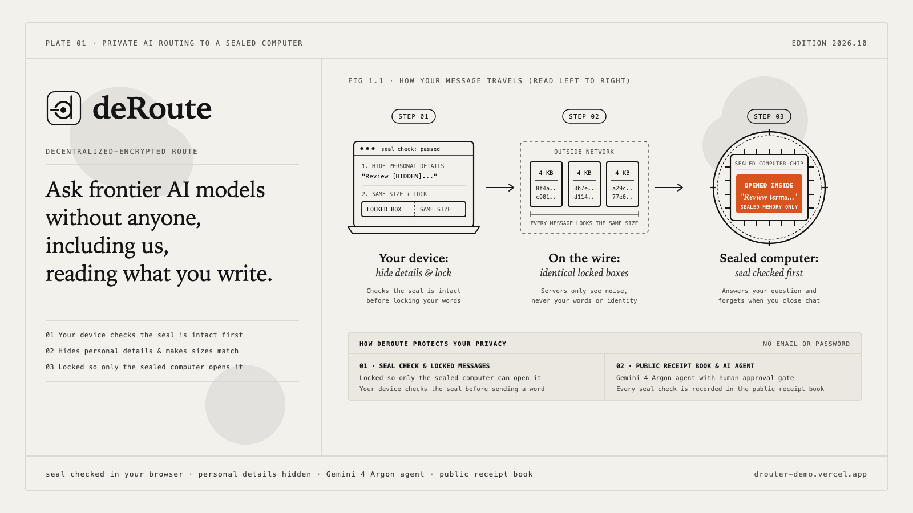

# dRouter: Hardware-Attested Confidential AI Inference Router



dRouter is a privacy-preserving AI inference router that verifies hardware attestation quotes from CPU and GPU Trusted Execution Environments (TEEs) in the client before sealing prompts with RFC 9180 HPKE encryption. It combines on-device PII and secret scrubbing, homomorphic symmetry masking, Gemini 4 Argon autonomous security orchestration, MongoDB Atlas hybrid search, and Circle Arc Testnet receipt settlement so cloud relays and model hosts cannot read raw user secrets.

Live deployment: https://drouter-demo.vercel.app
Source: https://github.com/thepigdestroyer/drouter

## Who It Is For

The default workflow is built around **Dana Reyes**, a fictional clinical data scientist on an Oncology Trial Unit at Riverside Teaching Hospital. She needs to audit survival analysis pipelines, de-identified case notes, and R/Python statistical code without exposing patient cohort identifiers, grant figures, or API credentials to cloud model providers.

*Pitch note for the team:* `DEMO_PERSONA` in `src/lib/gemini/orchestrator.ts` is a fictional example persona so no personal data is committed to the repository. Before pitching to judges, replace `DEMO_PERSONA` with a real, consenting user and their actual workflow.

## Google DeepMind Gemini 4 Argon Integration (`src/lib/gemini/`, `/api/gemini`, `/argon`)

dRouter implements a 6-stage autonomous verification and routing loop using the official `@google/genai` SDK (v2.31.0) and `client.interactions.create`.

### Truthful Model & Agent Usage

| Model / Component | Status in Code | How It Is Used |
|---|---|---|
| `gemini-4-argon` | Live when `GEMINI_API_KEY` is provided; simulated fallback otherwise | Primary orchestrator called via `client.interactions.create` with `generation_config: { thinking_level: "low" \| "medium" \| "high", max_output_tokens }` and `background: true`. Executes a multi-turn function-calling loop over 6 confidential tools (`scrub_and_symmetry_mask`, `verify_two_hop_enclave_and_quorum`, `search_atlas_hybrid_kb`, `run_antigravity_vmpl0_and_memory_audit`, `invoke_attested_enclave`, `anchor_arc_settlement_with_human_gate`). |
| `gemini-3.8-flash` | Live when `GEMINI_API_KEY` is provided; simulated fallback otherwise | Parallel Stage 2 subagent called via `client.interactions.create` to summarize MongoDB Atlas Hybrid Search (`$rankFusion`) and Tinfoil 2-hop attestation results. |
| `gemini-3.5-flash-lite` | Live when `GEMINI_API_KEY` is provided; simulated fallback otherwise | Parallel Stage 2 subagent called via `client.interactions.create` to summarize the 5-of-7 Ed25519 hardware verifier quorum check. |
| `gemma4-31b` / `kimi-k3` | Live attested Tinfoil enclave models when `TINFOIL_API_KEY` is set | Invoked over RFC 9180 HPKE Encrypted HTTP Body (EHBP) via `TinfoilAI` on `gemma4-31b-inf10-0.tinfoil.containers.tinfoil.dev` or `kimi-k3-inf14.tinfoil.containers.tinfoil.dev` through `router-0.tinfoil.sh`. |
| `antigravity-preview-09-2026` | Not used (local TypeScript verifier) | Marked `not-used` in the toolkit manifest. Stage 3 runs deterministic local TypeScript verifiers (`verifyMonitorPolicyExhaustive` across all 1,344 VMPL0 states and `runMemoryBusAndPopAudit`). |
| `deep-research-preview-04-2026` | Not used | Marked `not-used`. Hardware advisories (TEE.fail, DDRop, Cipherleaks, VoltPillager) are retrieved from MongoDB Atlas Hybrid Search. |
| `gemma-4-e4b` | Not used (local TypeScript scrubber) | Marked `not-used`. Stage 1 runs deterministic local regex scrubbing (`src/lib/privacy/scrubber.ts`) and homomorphic symmetry masking (`src/lib/symmetry/homomorphism.ts`). |
| `gemini-3.8-live` / `gemini-3.8-flash-tts` | Not used | Marked `not-used`. Stage 5 human approval is gated via HTTP/UI and Stage 6 produces a text briefing plus an Ed25519-signed SHA-256 forensic digest. |

### Key Safeguards in the Agent Loop

1. **Strict Argon API Contract (`validateArgonRequestConfig`)**: Enforces `model: "gemini-4-argon"`, `thinking_level` (`"low" | "medium" | "high"`, default `"medium"`), and `background: true` for long decode (> 65,536 tokens). Rejects legacy parameters (`thinking_budget`, `temperature`, `top_p`, `top_k`, and `cached_content`) with HTTP 400.
2. **Privacy Invariant (`assertOutboundPrivacyInvariant`)**: Google only ever receives scrubbed and symmetry-masked text. Before every `client.interactions.create` call, code inspects the serialized request payload and aborts with `PrivacyInvariantViolationError` if any original placeholder value or sensitive token is present.
3. **Real Fault Injection & Self-Healing (`injectFaultToTestSelfHealing`)**: Tampering a candidate node (`simulated-compromised-node`) corrupts the enclave measurement registers, confidential GPU flags, and VMPL0 exit policy so the real `verifyModelEnclaveStatus` and `verifyMonitorPolicyExhaustive` checks fail (`C5_ConfidentialGpuFlagsTampered`, `C7_DmVerityMeasurementTampered`, `I1_NoPlaintextEgress`). The orchestrator quarantines the faulty node and re-verifies on the live attested Tinfoil enclave.
4. **Human-in-the-Loop Gate (Stage 5)**: External state changes on Circle Arc Testnet are blocked (`paused_awaiting_human`, `stateChangedOnChain: false`) unless the request explicitly sets `humanApprovedExternalAction: true`.

## MongoDB Atlas Integration (`src/lib/atlas/`, `/api/atlas`, `scripts/atlas-indexes.mjs`)

dRouter runs against a live MongoDB Atlas M0 cluster (`drouter`, database `drouter`, MongoDB 8.0.34 Enterprise).

### Truthful Atlas Features Used

1. **Atlas Search (`$search`)**: Uses the `drouter_text_search` Lucene index (`standard` analyzer on `title`, `summary`, `tags`; `keyword` analyzer on `category`) on `drouter.enclave_intelligence`.
2. **Atlas Vector Search (`$vectorSearch`)**: Uses the `drouter_vector_index` kNN index (128 dimensions, `cosine` similarity on `embedding`, pre-filter on `category`).
3. **Native Hybrid Search (`$rankFusion`)**: Executes MongoDB 8.0's native `$rankFusion` stage combining `vectorPipeline` (`$vectorSearch`) and `textPipeline` (`$search`) with `scoreDetails: true`. Falls back to application-side Reciprocal Rank Fusion (`app-rrf`) only if Atlas is unreachable. Every `/api/atlas` response reports the active engines in `engines: { vectorSearch, textSearch, fusion, embedding }`.
4. **Embeddings (`engines.embedding`)**: Atlas Automated Embedding (`type: "autoEmbed"` with Voyage AI models) requires MongoDB 8.2+ and an Atlas Model API key, so `autoEmbed` indexes remain `PENDING` on MongoDB 8.0.34 M0. When `VOYAGE_API_KEY` is set, dRouter calls the live Voyage AI Embeddings API (`voyage-3-lite`). When `VOYAGE_API_KEY` is not set, dRouter uses a deterministic 128-dimensional unit-normalized feature-hash vector and reports it honestly as `"local-hashed-128 (stand-in)"`.
5. **Core Agent Verification Receipts (`agent_verification_receipts`)**: Every `/api/gemini` run stores a signed verification receipt in `drouter.agent_verification_receipts` with timestamps coarsened to the UTC hour boundary (`YYYY-MM-DDTHH:00:00.000Z`) and zero prompts or PII. The agent's Atlas search tool queries both `enclave_intelligence` and `agent_verification_receipts`.
6. **Multi-Collection `$facet` Aggregation (`runAtlasStreamAnalytics`)**: Runs standard `$facet` and `$group` aggregations across `enclave_intelligence`, `agent_verification_receipts`, `verifications`, `receipts`, `relay_totals`, `credit_nullifiers`, and `frozen_blobs`. (Atlas Stream Processing workspaces and change streams are not used on M0.)
7. **Authenticated, Size-Capped Ingest**: HTTP `POST /api/atlas` with `action: "ingest"` requires a valid `X-Atlas-Ingest-Token` header matching `ATLAS_INGEST_TOKEN`, caps documents at 8,192 bytes, and rejects any payload containing a `prompt` field.

## Architecture

1. **Local Privacy & Symmetry Boundary (`src/lib/privacy/`, `src/lib/symmetry/`)**: Strips secrets, emails, phone numbers, wallets, and custom entities into `[KIND_N]` placeholders, shifts ISO dates and scales currency figures homomorphically, and pads JSON frames to 4,096-byte RFC 8259 power-of-two buckets.
2. **2-Hop Attested Enclave Verification (`src/lib/tinfoil/`)**: Verifies Hop 1 (`router-0.tinfoil.sh`, AMD SEV-SNP) and Hop 2 (`kimi-k3-inf14.tinfoil.containers.tinfoil.dev` or `gemma4-31b-inf10-0.tinfoil.containers.tinfoil.dev`, Intel TDX + NVIDIA Confidential Computing GPUs) against Sigstore Rekor transparency logs and pinned dm-verity root hashes.
3. **Oblivious Relay (`src/lib/relay.ts`, `/api/relay`)**: Forwards HPKE-encrypted payloads to `*.tinfoil.sh` without reading prompts or completions, pacing streamed responses on a 50 ms cadence.
4. **MongoDB Atlas Data Plane (`src/lib/atlas/`, `src/lib/db.ts`)**: Stores the confidential provider and hardware advisory knowledge base, coarsened verification receipts, aggregate relay byte counters, spent RSA blind credit nullifiers, and AES-256-GCM frozen session ciphertexts.
5. **Circle Arc Testnet Registry (`src/lib/arc/`)**: Anchors verification digests and batch receipts on Circle Arc Testnet (chain ID `5042002`, contract `0xbc8085c2b6fe6e0db05f169925c0b841828f4481`).

## How to Run Locally

1. Create `.env.local` in the project root with the following environment variable names (do not commit values):

```bash
MONGODB_URI=
MONGODB_DB=drouter
TINFOIL_API_KEY=
GEMINI_API_KEY=
VOYAGE_API_KEY=
ATLAS_INGEST_TOKEN=
ARC_RPC_URL=
ARC_REGISTRY_ADDRESS=0xbc8085c2b6fe6e0db05f169925c0b841828f4481
ARC_VERIFIER_PRIVATE_KEY=
ARC_DEPLOYER_PRIVATE_KEY=
```

2. Seed MongoDB Atlas and verify search indexes are `READY`:

```bash
node --env-file=.env.local scripts/atlas-indexes.mjs
```

3. Run the development server or test suites:

```bash
npm run dev
npx vitest run --config tests/gemini/vitest.config.ts
npx vitest run --config tests/atlas/vitest.config.ts
```

## CLI (`scripts/drouter-cli.mjs`)

dRouter includes a zero-trust terminal CLI and local OpenAI-compatible proxy that verifies Tinfoil enclave attestation and scrubs PII locally before sending HPKE-encrypted requests:

```bash
# 1. Verify live 2-hop enclave attestation and print the C1-C7 checklist
node scripts/drouter-cli.mjs verify --upstream http://localhost:3000

# 2. Ask a question with local PII scrubbing and streaming placeholder restoration
node scripts/drouter-cli.mjs ask "Audit cohort RTH-COHORT-2026-08-14 for dana.reyes@example.org" --model kimi-k3 --upstream http://localhost:3000

# 3. Start a local zero-trust OpenAI-compatible proxy on http://127.0.0.1:4141/v1
node scripts/drouter-cli.mjs proxy --port 4141 --upstream http://localhost:3000
```

## Ground-Truth Limitations & Caveats

- **Tinfoil Hardware & Context Limits**: Tinfoil's ingress router (`router-0.tinfoil.sh`) attests with AMD SEV-SNP. The Kimi K3 enclave (`kimi-k3-inf14.tinfoil.containers.tinfoil.dev`) runs on Intel TDX plus 8x NVIDIA Confidential Computing GPUs with a maximum context length (`max-model-len`) of 262,144 tokens (not 1,000,000 tokens; the 1,000,000-token context window belongs to `gemini-4-argon`). Live enclave status is published at `https://inference.tinfoil.sh/.well-known/tinfoil-proxy`.
- **Tinfoil Sidecars**: Tinfoil's router enclave runs an acceptable-use "safeguards" classifier sidecar reporting to `https://api.tinfoil.sh` and a token usage reporter.
- **Simulated Enclave Nodes**: Nodes `sim-1`, `sim-2`, and `sim-3` (`src/lib/sim/`) are software simulations used for deterministic testing and fault injection, not physical SEV-SNP hardware.
- **Gemini Simulated Mode When Key Is Absent**: When `GEMINI_API_KEY` is not set in the environment or request, `/api/gemini` runs in `mode: "simulated"`. All local verifiers (scrubber, symmetry masking, live Tinfoil attestation check, MongoDB Atlas `$rankFusion` search, 1,344-state VMPL0 check, and V1/V6 memory-bus audit) execute for real, and `TINFOIL_API_KEY` calls the live Tinfoil enclave on `POST /api/gemini`, while Gemini model outputs are labeled as simulated.
- **MongoDB Atlas M0 Tier Limits**: The live `drouter` cluster is an Atlas M0 free-tier cluster on MongoDB 8.0.34. Native `$vectorSearch`, `$search`, and `$rankFusion` execute on Atlas, whereas Automated Embedding (`autoEmbed`, which requires MongoDB 8.2+ and an Atlas Model API key) and Atlas Stream Processing workspaces are not supported on this tier.
