# deRoute architecture, in pictures

This guide explains how deRoute works using diagrams that render directly on GitHub. Each one starts with a plain explanation, then the diagram, then the technical detail. Image copies (SVG and PNG) and the Mermaid sources live in [`docs/diagrams/`](diagrams/).

## The seven building blocks at a glance

Your words are filtered on your device, sealed so only a verified sealed computer can read them, and paid for without a name. Gemini plans from a description that contains none of your words, and everything that can be checked is checked in public.

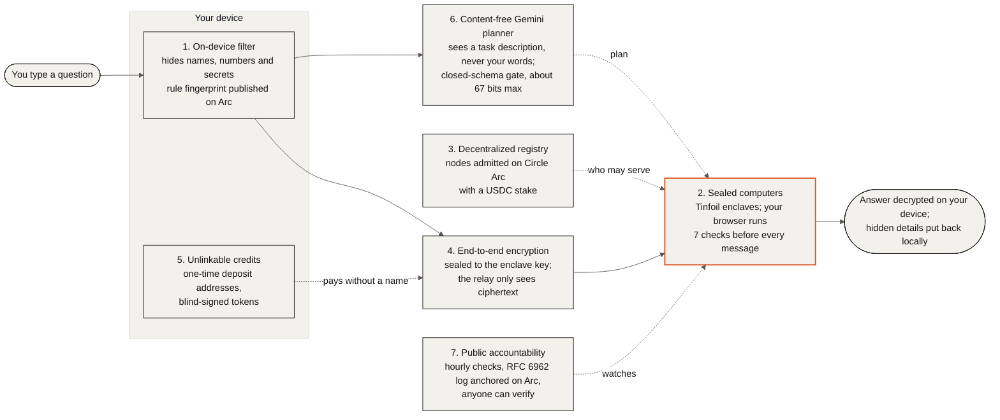

## Contents

- [System Overview (01-overview)](#system-overview-01-overview)
- [Trust Boundaries by Party (02-trust-boundaries)](#trust-boundaries-by-party-02-trust-boundaries)
- [Confidential Chat Lifecycle (03-chat-lifecycle)](#confidential-chat-lifecycle-03-chat-lifecycle)
- [Seven Pre-Send Verification Checks (04-seven-checks)](#seven-pre-send-verification-checks-04-seven-checks)
- [Split-Knowledge Agent Lifecycle (05-agent-lifecycle)](#split-knowledge-agent-lifecycle-05-agent-lifecycle)
- [Outbound Egress Gate (06-egress-gate)](#outbound-egress-gate-06-egress-gate)
- [Continuous Enclave Verification & RFC 6962 Transparency Log (07-verification)](#continuous-enclave-verification-rfc-6962-transparency-log-07-verification)
- [Anonymous Deposit Invoices & RSA Blind-Signed Credits (08-payments)](#anonymous-deposit-invoices-rsa-blind-signed-credits-08-payments)
- [On-Device Filter Fingerprint & Circle Arc Verification (09-filter-fingerprint)](#on-device-filter-fingerprint-circle-arc-verification-09-filter-fingerprint)
- [Split-Path Knowledge Retrieval: Whole-Library BM25 vs. Atlas Hybrid Search (10-knowledge)](#split-path-knowledge-retrieval-whole-library-bm25-vs-atlas-hybrid-search-10-knowledge)

## System Overview (`01-overview`)

deRoute splits confidential AI execution across the user's browser, an oblivious Next.js relay on Vercel, hardware-attested Tinfoil enclaves, a content-free Gemini control-plane planner, MongoDB Atlas, and the Circle Arc Testnet registry. Personal text is filtered and encrypted on the device before transmission, while public coordination, knowledge retrieval, and hourly enclave audits leave verifiable cryptographic proofs.

```mermaid
%%{init: {"theme":"base","themeVariables":{"primaryColor":"#f3f1ec","primaryTextColor":"#151515","primaryBorderColor":"#151515","lineColor":"#595752","secondaryColor":"#ffffff","tertiaryColor":"#f3f1ec","fontFamily":"Georgia, serif"}}}%%
flowchart TB
  subgraph Client["User Device"]
    Browser["Browser<br/>On-Device Filter (D3), Symmetry Masking,<br/>C1-C7 Verifier, HPKE Client, Blind Credits"]
  end

  subgraph Vercel["Vercel Next.js App & Oblivious Relay"]
    Relay["Oblivious Relay (/api/relay/v1/*, /api/relay/[relayId]/v1/*)<br/>Adds TINFOIL_API_KEY, Spends x-drouter-credit, Paces Frames"]
    AttestRoutes["Attestation & Matrix Routes<br/>(/api/relay/attestation, /api/relay/enclave-matrix)"]
    PlanRoute["Planner Route (POST /api/gemini/plan)<br/>Closed-Schema Gate + Egress Receipt Signer"]
    CorpusRoute["Corpus & Search Routes<br/>(GET /api/knowledge/corpus, /api/atlas/*)"]
    CronRoute["Hourly Monitor & Registry Routes<br/>(/api/cron/monitor, /api/registry, /api/anchor)"]
  end

  subgraph Tinfoil["Tinfoil Confidential Enclaves"]
    RouterEnclave["Tinfoil Router Enclave (router-0.tinfoil.sh)<br/>AMD SEV-SNP + ATC Attestation"]
    PiiEnclave["Tinfoil pii-filter Enclave<br/>Attested Second-Pass Redaction (D4)"]
    ModelEnclaves["Tinfoil Model Enclaves<br/>(kimi-k3, glm-5-3, deepseek-v4-1-flash,<br/>gpt-oss-120b, llama3-3-70b, gemma4-31b, nomic-embed-text)"]
  end

  subgraph GCP["Google Cloud Confidential Space (built, not yet deployed)"]
    DerouteCore["deroute-core Confidential VM (port 8443)<br/>built, not yet deployed<br/>(/knowledge/corpus, /agent/plan, /transparency/sign-tree-head)"]
  end

  subgraph External["External Control Plane, Storage, Ledger & Scheduler"]
    Gemini["Google Gemini Control Plane (gemini-4-argon)<br/>Content-Free Planner (~67-bit TaskDescriptor)"]
    Atlas["MongoDB Atlas (drouter)<br/>enclave_intelligence (768-dim Vector + BM25 $rankFusion),<br/>agent_verification_receipts, credit_nullifiers"]
    Arc["Circle Arc Testnet Registry (chainId 5042002)<br/>Node Admissions, Stake, Verification & Receipt Anchors"]
    GHActions["GitHub Actions Hourly Monitor<br/>(.github/workflows/monitor.yml: cron 17,47 * * * *)"]
  end

  Browser -->|"RFC 9180 HPKE Ciphertext + x-drouter-credit"| Relay
  Browser -->|"Verify Enclave Bundle & Matrix"| AttestRoutes
  Browser -->|"Content-Free TaskDescriptor"| PlanRoute
  Browser -->|"GET Whole Public Corpus (zero query params)"| CorpusRoute
  Browser -->|"Read Anchor Receipt (eth_getTransactionReceipt)"| Arc

  Relay -->|"HPKE Ciphertext + Bearer TINFOIL_API_KEY"| RouterEnclave
  Relay -->|"HPKE Second-Pass Redaction"| PiiEnclave
  RouterEnclave -->|"Verified Backend Routing"| ModelEnclaves
  AttestRoutes -->|"Fetch SEV-SNP / TDX / Sigstore Bundles"| RouterEnclave

  PlanRoute -.->|"Verify-Then-Pin TLS (/api/core/agent/plan)<br/>built, not yet deployed"| DerouteCore
  DerouteCore -.->|"Content-Free createRequest"| Gemini
  PlanRoute -->|"Fallback: Content-Free createRequest"| Gemini

  CorpusRoute -->|"Load Public Corpus / Hybrid RRF Search"| Atlas
  Relay -->|"Atomic Spend (credit_nullifiers) & Byte Counts"| Atlas
  PlanRoute -->|"Append Merkle Transparency Log Event"| Atlas

  GHActions -->|"POST /api/cron/monitor (Bearer CRON_SECRET)"| CronRoute
  CronRoute -->|"Re-verify Enclaves"| RouterEnclave
  CronRoute -->|"recordVerification & anchorReceipt"| Arc
  CronRoute -->|"Store Coarsened Verification Run"| Atlas

  style Browser stroke:#d9531e,stroke-width:2.5px,fill:#ffffff,color:#151515
  style DerouteCore stroke:#595752,stroke-width:2px,stroke-dasharray: 6 4,fill:#f3f1ec,color:#151515
  style GCP stroke:#595752,stroke-width:1.5px,stroke-dasharray: 6 4,fill:#f3f1ec,color:#151515
```

- **Oblivious Relay and Enclave Routing (`src/lib/relay.ts`, `src/app/api/relay/**`)**: The browser verifies Tinfoil's AMD SEV-SNP router (`router-0.tinfoil.sh`) and model enclaves (`kimi-k3`, `glm-5-3`, `deepseek-v4-1-flash`, `gpt-oss-120b`, `llama3-3-70b`, `gemma4-31b`, `nomic-embed-text`, and `pii-filter`), pads JSON payloads to power-of-two byte buckets, and seals requests with RFC 9180 HPKE (`ehbp-encapsulated-key`). The Next.js relay validates the target origin (`*.tinfoil.sh`, `*.tinfoil.dev`), spends optional `x-drouter-credit` blind tokens, injects `Bearer ${TINFOIL_API_KEY}`, paces response streams, and logs only encrypted byte counts.
- **Content-Free Gemini Planner (`src/app/api/gemini/plan/route.ts`)**: `POST /api/gemini/plan` rejects query parameters, validates the incoming `TaskDescriptor` against a closed schema (`assertGoogleBoundMessage` and `assertContentFree`), and routes planning to `deroute-core` when available or directly to `gemini-4-argon` on the Next.js server when `GEMINI_API_KEY` is configured, returning a signed `GeminiEgressReceipt` with a Merkle transparency log inclusion proof.
- **Google Cloud Confidential Space Workload (`docs/confidential-space.md`)**: `deroute-core` (drawn dashed as built, not yet deployed) is designed to run inside a hardware-isolated Google Cloud Confidential Space VM on port `8443` with in-memory `egress-signing` and `tree-signing` Ed25519 keys bound to the PKI attestation token `eat_nonce` and reached via verify-then-pin TLS from `/api/core/[...path]`.
- **MongoDB Atlas Knowledge Base and Telemetry (`src/lib/atlas/**`, `src/app/api/knowledge/corpus/route.ts`)**: `GET /api/knowledge/corpus` serves the identical sorted 16-document public corpus with a `contentSha256` ETag and zero query parameters so browsers can rank documents locally without leaking topic interest, while `runAtlasHybridSearch` combines 768-dimensional `$vectorSearch`, Lucene `$search`, and MongoDB 8.0 `$rankFusion` over D3/D4-redacted queries.
- **Circle Arc Testnet Registry and Hourly Monitor (`src/lib/arc/**`, `.github/workflows/monitor.yml`)**: GitHub Actions triggers `POST /api/cron/monitor` twice per hour (`17 * * * *` and `47 * * * *`) to re-verify live Tinfoil enclaves and anchor verification records (`recordVerification`, `anchorReceipt`) on the Circle Arc Testnet contract (`chainId 5042002`).

## Trust Boundaries by Party (`02-trust-boundaries`)

Only your device ever sees what you actually typed. Raw user text stays exclusively on the user's device, redacted prompts travel only inside end-to-end HPKE ciphertext to hardware-attested enclaves, and external services (our Next.js server, Google Gemini, MongoDB Atlas, and the Circle Arc blockchain) receive only content-free descriptors, filtered public search terms, or public hash anchors.

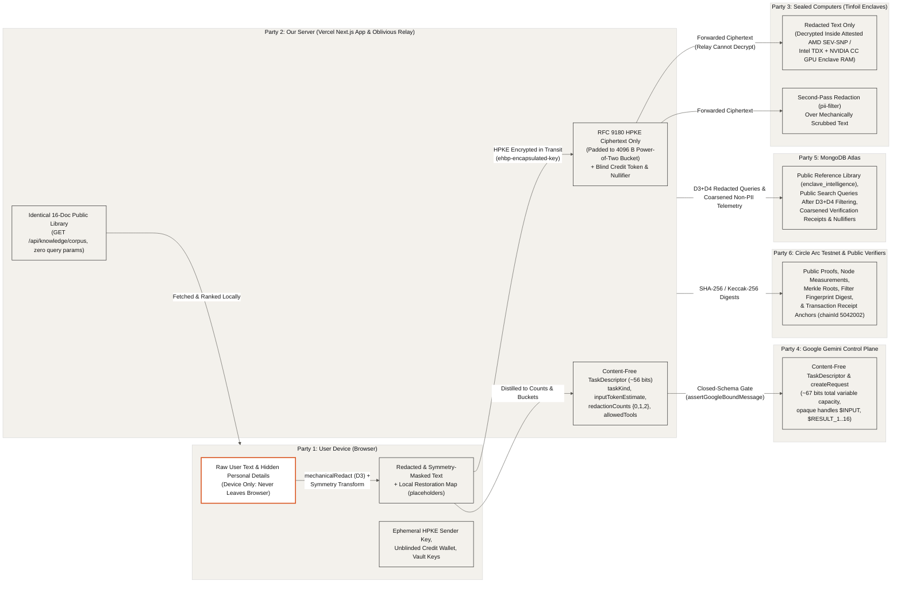

- **Device-Only Plaintext (`src/components/console/send-pipeline.ts`, `src/lib/privacy/mechanical.ts`)**: Raw user text, custom scrub terms from the WebAuthn/PBKDF2 vault, placeholder restoration maps (`[EMAIL_1]`, `[SECRET_1]`), and symmetry shift factors remain in browser memory and never cross a network socket.
- **Redacted Text Encrypted in Transit to Sealed Computers (`src/lib/tinfoil/client.ts`, `src/lib/relay.ts`)**: Before leaving the browser, scrubbed text is padded to a power-of-two byte bucket (`padJsonPayloadToBucket`) and encrypted via RFC 9180 HPKE (`ehbp-encapsulated-key`) to the enclave's attested public key so only the Tinfoil enclave (`pii-filter` or model enclave) can decrypt the redacted prompt.
- **Content-Free Control Plane (`src/app/api/gemini/plan/route.ts`, `src/lib/gemini/egress-schemas.ts`)**: Both our Next.js server and Google Gemini (`gemini-4-argon`) receive only the closed-schema `TaskDescriptor` and `createRequest` containing enum values, power-of-two token buckets, coarse redaction counts (`{0, 1, 2}`), and opaque handles (`$INPUT`, `$RESULT_1..16`), validated by `assertGoogleBoundMessage` and `assertContentFree`.
- **Public Library and Filtered Queries on MongoDB Atlas (`src/app/api/knowledge/corpus/route.ts`, `src/lib/atlas/**`)**: Agent runs download the entire 16-document public reference library (`GET /api/knowledge/corpus` with zero query parameters) to rank in browser memory, while direct Atlas hybrid search (`runAtlasHybridSearch`) runs `redactForAtlasBoundary` (D3 + D4) before any query touches `$vectorSearch` or `$search` and forbids storing user text fields (`assertNoUserTextFields`).
- **Public Proofs and Anchors on Circle Arc Testnet (`src/lib/arc/**`, `src/lib/privacy/fingerprint.ts`)**: Only 32-byte cryptographic hashes (enclave measurements, Merkle transparency roots, forensic receipt digests, and the published filter ruleset fingerprint) are anchored on Circle Arc Testnet (`chainId 5042002`).

| Party | What This Party Can See | What This Party Cannot See | Enforcement Mechanism |
| :--- | :--- | :--- | :--- |
| **User Device (Browser)** | Raw user text, redacted text, placeholder restoration table, symmetry parameters, unblinded credits, and all verification receipts. | Operator secrets (`TINFOIL_API_KEY`, `GEMINI_API_KEY`, `MONGODB_URI`, `ARC_VERIFIER_PRIVATE_KEY`). | Client-side execution in browser memory (`src/components/console/send-pipeline.ts`, `src/lib/agent-client/index.ts`). |
| **Sealed Computers (Tinfoil Enclaves)** | Redacted and symmetry-masked text (decrypted inside hardware-encrypted enclave RAM), padded to a power-of-two byte bucket. | Original unredacted names, emails, secrets, or user IP addresses (hidden behind the Vercel relay). | On-device `mechanicalRedact` (D3), symmetry masking, RFC 9180 HPKE (`ehbp-encapsulated-key`), and AMD SEV-SNP / Intel TDX attestation. |
| **Our Server (Vercel Next.js App & Relay)** | HPKE ciphertext byte length (bucketed), blind credit token and nullifier, and the content-free `TaskDescriptor` (`~56 bits`). | Raw user text, redacted prompt text, model completions, or linkable payment identity. | End-to-end HPKE to enclave key (`src/lib/relay.ts`), Chaumian RSA blind signatures (`src/lib/credits/blind.ts`), and closed schema validation. |
| **Google Gemini (`gemini-4-argon`)** | Content-free `TaskDescriptor` and `createRequest` (`~67 bits` total variable information) over opaque handles (`$INPUT`, `$RESULT_1..16`). | Raw user text, redacted prompt text, enclave outputs, or full SHA-256 digests (`> 16` hex chars). | Dual fail-closed egress gates (`assertGoogleBoundMessage` and `assertContentFree` in `src/lib/gemini/egress-schemas.ts`). |
| **MongoDB Atlas** | 16-document public reference library, public search queries after D3+D4 redaction, coarsened UTC-hour verification receipts, and credit nullifiers. | Raw user prompts, unscrubbed search queries, exact request timestamps, or payer wallet addresses. | Whole-corpus fetch (`GET /api/knowledge/corpus`), `redactForAtlasBoundary`, `assertNoUserTextFields`, and `coarsenIsoToUtcHour`. |
| **Circle Arc Testnet (Public)** | Registered enclave node IDs, hardware measurement hashes, published filter fingerprint anchor, and 32-byte receipt digests. | Any prompt text, descriptor fields, or private keys. | 32-byte hash arguments in `recordVerification` and `anchorReceipt` (`src/lib/arc/registry.ts`). |

## Confidential Chat Lifecycle (`03-chat-lifecycle`)

When a user sends a chat message, the browser first verifies that its local personal-detail filter matches the published ruleset anchored on Circle Arc Testnet and scrubs sensitive terms on the device. It then verifies all seven enclave checks (`C1` through `C7`), pads and HPKE-encrypts the scrubbed prompt to the enclave's attested public key, attaches an unlinkable blind-signed credit token for the relay, and restores the hidden details locally after decrypting the enclave's reply.

```mermaid
%%{init: {"theme":"base","themeVariables":{"primaryColor":"#f3f1ec","primaryTextColor":"#151515","primaryBorderColor":"#151515","lineColor":"#595752","secondaryColor":"#ffffff","tertiaryColor":"#f3f1ec","fontFamily":"Georgia, serif"}}}%%
sequenceDiagram
  autonumber
  actor User as User
  participant Browser as Browser (send-pipeline.ts & tinfoil/client.ts)
  participant Arc as Circle Arc Testnet (chainId 5042002)
  participant Relay as Vercel Oblivious Relay (/api/relay/v1/*)
  participant Enclave as Tinfoil Enclave (Router + Model CVM)

  User->>Browser: Types raw prompt with personal details
  Browser->>Browser: Recompute SHA-256 of MECHANICAL_RULESET (verifyFilterFingerprint)
  Browser->>Arc: Read-only eth_getTransactionReceipt(anchorTx) for published-fingerprint.json
  Arc-->>Browser: Confirm on-chain filter fingerprint receipt (or block send on mismatch)
  Note over Browser: assertFilterFingerprintAllowsSend() passes,<br/>preparePrompt() scrubs PII/secrets/vault terms,<br/>normalizes style, and pops 1 blind credit (takeCreditHeader)

  Browser->>Relay: GET /api/relay/attestation & GET /api/relay/enclave-matrix
  Relay->>Enclave: Fetch AMD SEV-SNP report, VCEK, Sigstore bundle & proxy table
  Enclave-->>Relay: Attestation bundle + model enclave matrix
  Relay-->>Browser: Return attestation bundle & deep inspection matrix

  Note over Browser: Verify Seven Checks (checksFromDocument):<br/>C1: Hardware signature chain<br/>C2: Approved software<br/>C3: HPKE key bound to enclave report<br/>C4: Running code = released code<br/>C5: Router-attested confidential GPU pool<br/>C6: Registry admission<br/>C7: Manifest-pinned model & dm-verity root

  Browser->>Browser: Pad JSON to 4096 B power-of-two bucket (padJsonPayloadToBucket)<br/>& seal with RFC 9180 HPKE to enclave hpkePublicKey

  Browser->>Relay: POST /api/relay/v1/chat/completions<br/>(HPKE ciphertext + ehbp-encapsulated-key + x-drouter-credit)
  Note over Relay: verifyAndSpendCreditHeader():<br/>Verify Chaumian RSA blind signature (e in 65537, 65539, 65543),<br/>atomically record nullifier in credit_nullifiers,<br/>refill rate bucket, and inject Authorization: Bearer TINFOIL_API_KEY

  Relay->>Enclave: Forward HPKE ciphertext + ehbp-encapsulated-key + Bearer API key
  Enclave->>Enclave: Decrypt inside enclave RAM, run model on redacted text, HPKE-encrypt stream
  Enclave-->>Relay: Encrypted SSE stream + ehbp-response-nonce
  Relay-->>Browser: Pace frames (pacedStream, 50 ms cadence) + X-DRouter-Credit-Nullifier

  Browser->>Browser: Decrypt HPKE stream & restore placeholders via prepared.restore()
  Browser-->>User: Render restored response with local privacy & attestation receipt
```

- **On-Device Filter and Fingerprint Gate (`src/components/privacy/filter-fingerprint-badge.tsx`, `src/components/console/send-pipeline.ts`)**: Before any message is prepared, `assertFilterFingerprintAllowsSend()` recomputes the SHA-256 digest of `MECHANICAL_RULESET` in the browser and compares it against `published-fingerprint.json` (whose anchor transaction is verified on Circle Arc Testnet via `eth_getTransactionReceipt`); any mismatch throws `FilterFingerprintMismatchError` and blocks sending.
- **Client-Side Redaction and Padding (`src/components/console/send-pipeline.ts`, `src/lib/relay.ts`)**: `prepareOutboundTurn()` loads active custom scrub terms from the unlocked local vault, runs `preparePrompt()` to replace PII and secrets with numbered placeholders (`[EMAIL_1]`, `[SECRET_1]`), and pads the outbound JSON payload with RFC 8259 trailing spaces to a power-of-two byte bucket (`padJsonPayloadToBucket`, minimum `4096` bytes) immediately prior to HPKE sealing.
- **Browser-Verified Seven Checks (`src/lib/tinfoil/client.ts`)**: `openTinfoilSession()` verifies the enclave attestation bundle and deep matrix in the browser across `C1` (`Hardware signature chain`), `C2` (`Approved software`), `C3` (`HPKE key bound to enclave report`), `C4` (`Running code = released code`), `C5` (`Router-attested confidential GPU pool`), `C6` (`Registry admission`), and `C7` (`Manifest-pinned model & dm-verity root`) before sealing the request with an ephemeral RFC 9180 HPKE sender key (`ehbp-encapsulated-key`).
- **Blind-Signed Credit Spend and Oblivious Relay (`src/lib/credits/**`, `src/app/api/relay/v1/[...path]/route.ts`)**: If the browser attaches an unblinded Chaumian RSA credit token in `x-drouter-credit`, the relay verifies its signature against the denomination's coprime exponent (`65537`, `65539`, or `65543` over a Full-Domain Hash in `Z_n^*`), atomically inserts `sha256("drouter/v1/credit-nullifier:" + token)` into `credit_nullifiers` to prevent double-spending, raises the ciphertext body cap to `512 KB`, and adds `Authorization: Bearer ${TINFOIL_API_KEY}` without ever seeing plaintext.
- **Cadence-Paced Encrypted Stream and Local Restoration (`src/lib/relay.ts`, `src/components/console/send-pipeline.ts`)**: The enclave returns an HPKE-encrypted stream (`ehbp-response-nonce`) which the relay flushes on a fixed interval (`pacedStream`, `50 ms`) and the browser decrypts and passes through `prepared.restore()` so original names and identifiers reappear only on the user's screen.

## Seven Pre-Send Verification Checks (`04-seven-checks`)

Before the browser encrypts or transmits a single prompt byte, it evaluates a seven-step verification checklist (`C1` through `C7`) against the live enclave attestation bundle, the Sigstore transparency log, the deep model enclave matrix, and the Circle Arc registry. If any check fails, the client aborts session setup immediately so no message can be sent to an unverified computer.

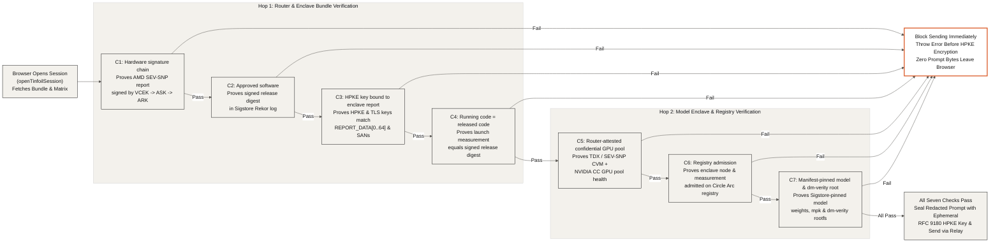

- **Hardware Root and Provenance (`C1: Hardware signature chain`, `C2: Approved software`)**: In `checksFromDocument()` (`src/lib/tinfoil/client.ts`), `C1` verifies the AMD SEV-SNP hardware attestation report all the way to AMD's root certificate chain (`VCEK -> ASK -> ARK`, ECDSA-P384 + RSASSA-PSS), while `C2` confirms that the enclave release digest (`tinfoil.hash`) is signed and recorded in the Sigstore Rekor transparency log.
- **Cryptographic Key Binding and Measurement Equality (`C3: HPKE key bound to enclave report`, `C4: Running code = released code`)**: `C3` proves that the enclave's RFC 9180 HPKE public key and TLS certificate fingerprint match `REPORT_DATA[0..64]` inside the hardware report, and `C4` confirms that the CPU's launch measurement register equals the measurement published in the signed release predicate.
- **Confidential GPU Pool and Pinned Weights (`C5: Router-attested confidential GPU pool`, `C7: Manifest-pinned model & dm-verity root`)**: Using `verifyModelEnclaveStatus()` (`src/lib/tinfoil/deep-inspect.ts`), `C5` verifies that the target model enclave pool runs on attested Intel TDX or AMD SEV-SNP confidential VMs with NVIDIA Confidential Computing GPU flags enabled, and `C7` verifies that the Sigstore DSSE predicate pins the exact Hugging Face weight commit, `mpk` package hash, and read-only `dm-verity` root filesystem hash.
- **On-Chain Admission and Fail-Closed Blocking (`C6: Registry admission`)**: `C6` checks the enclave node ID and measurement against the Circle Arc Testnet registry (`0xbc8085c2b6fe6e0db05f169925c0b841828f4481`), and any failure across `C1` through `C7` causes `openTinfoilSession()` (or the agent sandbox evaluator) to reject the target enclave before any prompt ciphertext is sealed or sent.

## Split-Knowledge Agent Lifecycle (`05-agent-lifecycle`)

The autonomous agent workflow in `src/lib/agent-client/index.ts` separates control-plane planning from confidential data execution so Google Gemini never sees user text or redacted text. The browser runs on-device mechanical redaction followed by an attested second pass through the `pii-filter` enclave, sends only a content-free `TaskDescriptor` to `POST /api/gemini/plan`, executes the returned plan steps in the browser (fetching the whole public corpus and sending the redacted task over HPKE to the model enclave), restores names on the device, and verifies the signed egress receipt with its Merkle inclusion proof.

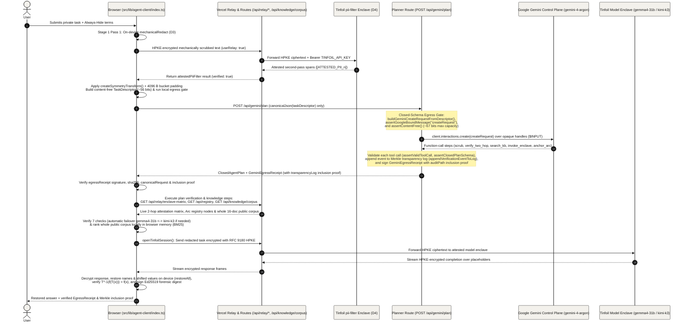

- **Two-Pass Redaction and Symmetry Masking (`runBrowserRedactionPipeline`)**: Stage 1 runs `mechanicalRedact` (D3) on the device first, sends the mechanically scrubbed text over HPKE through `/api/relay` to Tinfoil's attested `pii-filter` enclave (`attestedPiiFilter`, D4) for a second pass (`[ATTESTED_PII_n]`), applies reversible date/numeric/entity symmetry masking (`createSymmetryTransform`), and aligns the payload to a `4096`-byte power-of-two bucket.
- **Content-Free `TaskDescriptor` and Closed-Schema Egress Gate (`requestAgentPlanFromBrowser`, `src/app/api/gemini/plan/route.ts`)**: The browser distills the task into a content-free `TaskDescriptor` (`taskKind`, power-of-two `inputTokenEstimate`, bucketed `redactionCounts`, `verification` booleans, and `allowedTools`), verifies it locally with `assertOutboundPrivacyInvariant`, `assertGoogleBoundMessage("taskDescriptor")`, and `assertContentFree`, and posts only that descriptor to `POST /api/gemini/plan`, which re-verifies the closed schema before calling `gemini-4-argon` (`client.interactions.create`).
- **In-Browser Step Execution and Whole-Corpus Ranking (`runBrowserAgentWorkflow`)**: After validating the returned `ClosedAgentPlan` (`assertClosedPlanSchema`), the browser executes the verification and knowledge steps locally by fetching `/api/relay/enclave-matrix`, `/api/registry`, and the entire 16-document public knowledge corpus (`GET /api/knowledge/corpus` with zero query parameters, ranked in browser memory via `fetchWholeCorpusAndRankInBrowser`).
- **Direct Browser-to-Enclave HPKE Execution and Homomorphic Restoration (`openTinfoilSession`, `restoreAll`)**: The browser evaluates the target model enclave (`gemma4-31b` or `kimi-k3`, with automatic failover if hardware checks fail), sends the redacted prompt directly to the attested Tinfoil enclave over RFC 9180 HPKE, and runs `restoreAll()` and `verifyRedactionAndSymmetryRestore()` on the device to confirm $T^{-1}(f(T(x))) = f(x)$.
- **Signed Egress Receipt with Merkle Inclusion Proof (`verifyEgressReceiptClient`, `appendVerificationEventToLog`)**: `POST /api/gemini/plan` records the request SHA-256 in the append-only Merkle transparency log and returns a `GeminiEgressReceipt` containing the exact `canonicalRequest`, `sha256`, signer public key, and `transparencyLog` inclusion proof (`leafIndex`, `leafHash`, `treeSize`, `rootHash`, `auditPath`, `treeHeadSignature`), which the browser cryptographically verifies alongside its own Ed25519-signed Stage 6 forensic proof digest.

## Outbound Egress Gate (`06-egress-gate`)

Every message bound for Google Gemini must pass two independent, fail-closed validators before any network request is opened. Even if an attacker controls the input values, the closed schema restricts a `createRequest` payload to about 67 bits (8.36 bytes) of total variable information, and any schema or content violation immediately throws an error so nothing leaves the machine.

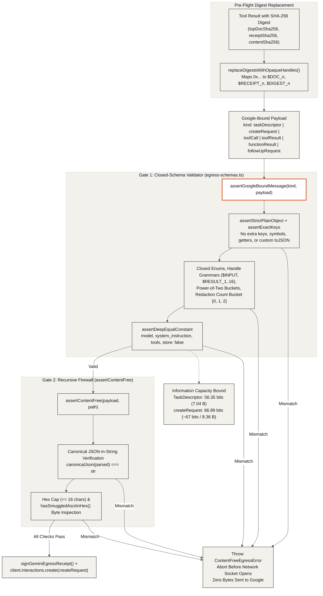

- **Closed-Schema Primary Gate (`assertGoogleBoundMessage`)**: Defined in `src/lib/gemini/egress-schemas.ts` (and mirrored in `core/src/firewall.js`), this validator dispatches on the exact message `kind` (`taskDescriptor`, `interactionsPayload`, `createRequest`, `toolCall`, `toolResult`, `functionResult`, `followUpRequest`) and enforces exact key sets, plain object prototypes, power-of-two integer buckets (`inputTokenEstimate`, `outputTokenEstimate`, `bucketQuantumBytes`, `bucketBytes`, `max_output_tokens`), coarse redaction buckets (`{0, 1, 2}` on `TaskDescriptor`), and deep equality against static constants (`model`, `system_instruction`, `ARGON_CONFIDENTIAL_TOOLS`, `store: false`).
- **Opaque Handle Substitution (`replaceDigestsWithOpaqueHandles`)**: Before any tool result is serialized into a Google-bound request, 64-character SHA-256 hex digests (`topDocSha256`, `receiptSha256`, `contentSha256`, `outputSha256`, `routerDigestHex`, `enclaveMeasurementHex`) are replaced with indexed handles (`$DOC_1..16`, `$RECEIPT_1..16`, `$DIGEST_1..16`, `$ROUTER_1..16`, `$MEASUREMENT_1..16`), keeping the raw hashes in server memory only.
- **Defense-in-Depth Recursive Firewall (`assertContentFree`)**: Runs immediately after `assertGoogleBoundMessage` to recursively inspect every key, primitive, array, and JSON-encoded string (`canonicalJson(parsed) === str`), enforcing `MAX_GOOGLE_BOUND_HEX_LENGTH = 16` and scanning any short hex bytes with `hasSmuggledAsciiInHex()`.
- **Information Capacity Bound (~67 Bits)**: Across all variable fields of a `createRequest` or `InteractionsCreatePayload` (`TaskDescriptor` at 56.35 bits, `thinking_level`, `background`, `max_output_tokens`, and canonical subsets of the 5 planner tools), the total combinatorial cardinality is $1.37 \times 10^{20}$, capping the maximum encodeable information at 66.89 bits (8.36 bytes) per request.
- **Fail-Closed Abort (`ContentFreeEgressError`)**: Any mismatch in either gate throws `ContentFreeEgressError` before `client.interactions.create` is invoked, guaranteeing that zero bytes are transmitted when an invariant fails.

## Continuous Enclave Verification & RFC 6962 Transparency Log (`07-verification`)

An hourly GitHub Actions monitor and independent command-line verifiers continuously check the hardware attestation, software release signatures, and model weight roots of all six real sealed computers. Every verification result is appended as a leaf to an RFC 6962 Merkle transparency log whose signed tree head is anchored on Circle Arc once per UTC hour.

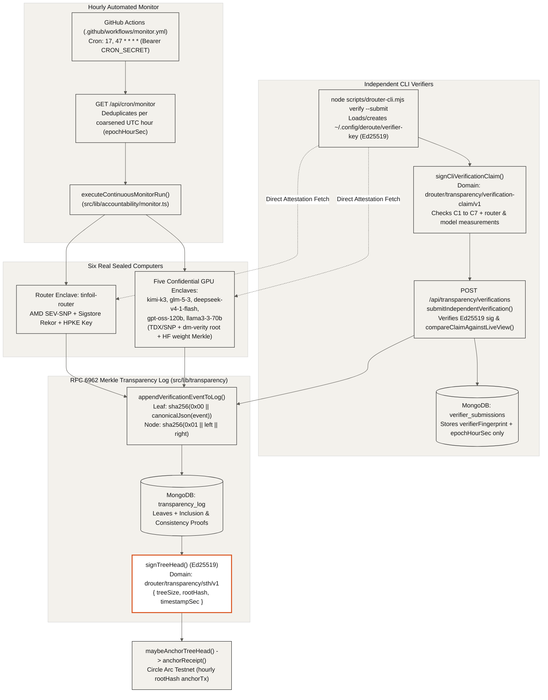

- **Hourly Monitor Across Six Sealed Computers**: `.github/workflows/monitor.yml` triggers `GET /api/cron/monitor` (`src/app/api/cron/monitor/route.ts`) with constant-time `CRON_SECRET` authentication at minutes `:17` and `:47`, deduplicating by `coarsenEpochSecToHour()` and executing `executeContinuousMonitorRun()` across `tinfoil-router` and the five model enclaves (`kimi-k3`, `glm-5-3`, `deepseek-v4-1-flash`, `gpt-oss-120b`, `llama3-3-70b`).
- **RFC 6962 Merkle Tree Construction**: `src/lib/transparency/log.ts` hashes each canonical event leaf with `sha256(0x00 || utf8(canonicalJson(entry)))` and internal nodes with `sha256(0x01 || left || right)`, producing client-verifiable inclusion proofs (`computeAuditPathFromLeaves`) and consistency proofs (`proveConsistencyFromLeaves`).
- **Signed Tree Head & Circle Arc Anchoring**: After appending leaves to `transparency_log`, `signTreeHead()` signs `{ domain: "drouter/transparency/sth/v1", rootHash, timestampSec, treeSize }` with the operator Ed25519 key, and `maybeAnchorTreeHead()` anchors `rootHash` on Circle Arc via `anchorReceipt()` at most once per hour.
- **Independent Verifier Claims (`drouter-cli.mjs verify --submit`)**: Anyone can run `node scripts/drouter-cli.mjs verify --submit` to verify the live router and model enclaves directly, sign a canonical C1 to C7 claim (`drouter/transparency/verification-claim/v1`) with their local Ed25519 key (`~/.config/deroute/verifier-key`), and submit it to `POST /api/transparency/verifications`.
- **Zero-Metadata Verifier Storage**: `submitIndependentVerification()` (`src/lib/transparency/store.ts`) verifies the Ed25519 signature, checks every claimed measurement against `getLiveVerificationView()`, records only `verifierFingerprint` (SHA-256 of the public key) and coarsened `epochHourSec` in `verifier_submissions`, and appends the verified claim to the transparency log.

## Anonymous Deposit Invoices & RSA Blind-Signed Credits (`08-payments`)

To pay for enclave inference without linking a wallet address to any prompt or session, the browser requests a one-time deposit address using only the SHA-256 hash of a local secret, deposits fixed-denomination USDC on Circle Arc, and claims RSA blind-signed credit tokens. When the browser later spends an unblinded token, the server verifies the RSA signature and records a SHA-256 nullifier, making the spend mathematically unlinkable to the invoice or on-chain payment.

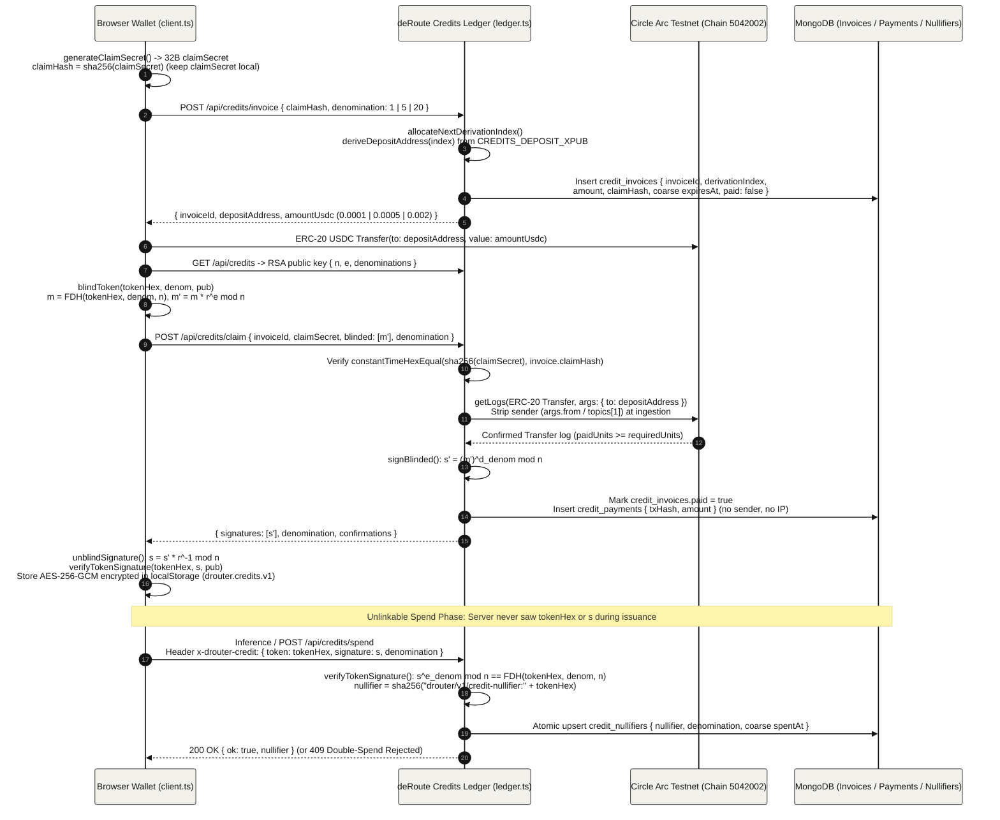

- **Watch-Only BIP32 Deposit Derivation (`deriveDepositAddress`)**: `src/lib/credits/ledger.ts` derives a fresh child address on Circle Arc Testnet (`chainId: 5042002`) from the public `CREDITS_DEPOSIT_XPUB` (`m/44'/60'/0'/0/<derivationIndex>`) while keeping the spending private key offline, and enforces fixed USDC denominations (`0.0001`, `0.0005`, or `0.002` USDC for `1`, `5`, or `20` credits) to prevent amount fingerprinting.
- **Hash-Committed Claim Secret & Sender Stripping**: The browser sends only `claimHash = sha256(claimSecret)` to `POST /api/credits/invoice` (which rejects requests containing `claimSecret` or payer addresses). On `POST /api/credits/claim`, `getUsdcTransferLogs()` queries ERC-20 `Transfer(to: depositAddress)` events on `0x3600000000000000000000000000000000000000` and strips `args.from` and `topics[1]` at ingestion so payer wallet addresses never enter memory or `credit_payments`.
- **Denomination-Bound RSA Full-Domain-Hash Blind Signatures**: `src/lib/credits/blind.ts` maps each random `tokenHex` and denomination into $\mathbb{Z}_n^*$ via HKDF-SHA-256 (`hashTokenMessage`) and uses distinct coprime public exponents per denomination (`1 -> 65537`, `5 -> 65539`, `20 -> 65543`) so a low-denomination signature cannot be forged into a high-denomination credit.
- **Encrypted Local Wallet Storage**: After unblinding `s = s' \cdot r^{-1} \bmod n` and verifying `verifyTokenSignature(creditToken, pub)` locally, `src/lib/credits/client.ts` encrypts the unspent tokens in `localStorage` (`drouter.credits.v1`) with AES-256-GCM under the active vault session key (or an ephemeral in-memory CSPRNG key) and AAD `drouter/v1/credits-wallet`.
- **Nullifier Double-Spend Protection**: When a credit is spent via `x-drouter-credit` or `POST /api/credits/spend`, the server verifies $s^{e_{\text{denom}}} \bmod n = \text{FDH}(\text{tokenHex}, \text{denom}, n)$ and atomically inserts `nullifier = sha256("drouter/v1/credit-nullifier:" + tokenHex)` into `credit_nullifiers` with a coarsened UTC-hour `spentAt` timestamp.

## On-Device Filter Fingerprint & Circle Arc Verification (`09-filter-fingerprint`)

All regular expressions, Unicode homoglyph tables, entropy thresholds, and allowlists for the on-device personal-detail filter live in a single serializable object (`MECHANICAL_RULESET`) whose canonical SHA-256 fingerprint is anchored on Circle Arc. Before sending any prompt, the browser recomputes that SHA-256 fingerprint locally, compares it against `published-fingerprint.json` and the Circle Arc transaction receipt log, and blocks sending if the running filter does not match.

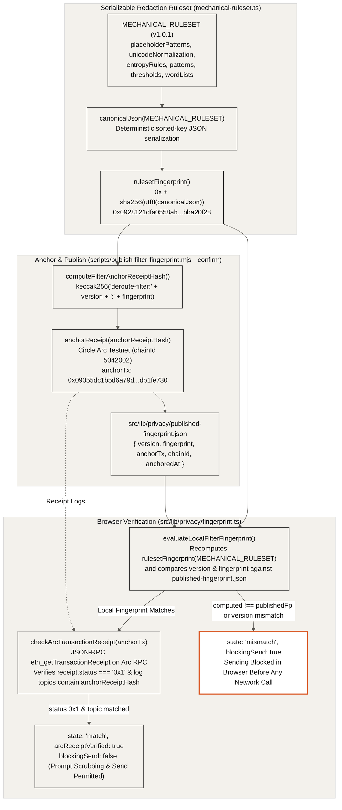

- **Canonical Ruleset Serialization (`MECHANICAL_RULESET`)**: `src/lib/privacy/mechanical-ruleset.ts` defines every pattern source, flag, Unicode normalization range, homoglyph map, entropy threshold, and word list in a pure data structure (`version: "1.0.1"`), which `rulesetFingerprint()` (`src/lib/privacy/fingerprint.ts`) hashes as `0x` + `sha256(utf8(canonicalJson(ruleset)))` (`0x0928121dfa0558ab8e59af0298aa76c5b9a3674012d2ff162b66df79bba20f28`).
- **Circle Arc Receipt Anchoring (`publish-filter-fingerprint.mjs`)**: Running `node scripts/publish-filter-fingerprint.mjs --confirm` computes `computeFilterAnchorReceiptHash(version, fingerprint) = keccak256("deroute-filter:" + version + ":" + fingerprint)`, anchors it on Circle Arc (`chainId: 5042002`) via `anchorReceipt()`, waits for receipt confirmation, and writes `{ version, fingerprint, anchorTx, chainId, anchoredAt }` to `src/lib/privacy/published-fingerprint.json` (`anchorTx: 0x09055dc1b5d6a79de9d96824ee76213b2c238a8bfd744ab143405d30db1fe730`).
- **Local Recomputation & Comparison (`evaluateLocalFilterFingerprint`)**: On page load and before sending, the browser recomputes `rulesetFingerprint(MECHANICAL_RULESET)` over the in-memory filter rules and compares both `version` and `computedFingerprint` against `published-fingerprint.json`.
- **Direct On-Chain Receipt Log Verification (`checkArcTransactionReceipt`)**: When the local hash matches, `verifyFilterFingerprint()` issues a read-only `eth_getTransactionReceipt` JSON-RPC call to `ARC_PUBLIC_RPC_URL` (`https://rpc.testnet.arc.network`) and verifies that `receipt.status === "0x1"` and that `receipt.logs` contains a topic matching `computeFilterAnchorReceiptHash(version, computed)`.
- **Fail-Closed Send Blocking (`blockingSend: true`)**: If the browser's computed fingerprint or version diverges from `published-fingerprint.json`, `evaluateLocalFilterFingerprint()` returns `state: "mismatch"` and `blockingSend: true`, preventing any prompt from being sent.

## Split-Path Knowledge Retrieval: Whole-Library BM25 vs. Atlas Hybrid Search (`10-knowledge`)

Private enclave runs never send a search query to the server; instead, the browser downloads the entire public intelligence corpus from `/api/knowledge/corpus`, verifies its canonical SHA-256 digest, and ranks documents locally with BM25. When a user explicitly uses the public hybrid search explorer, the typed text is scrubbed on the device and again on the server before running MongoDB Atlas `$vectorSearch`, `$search`, and `$rankFusion`.

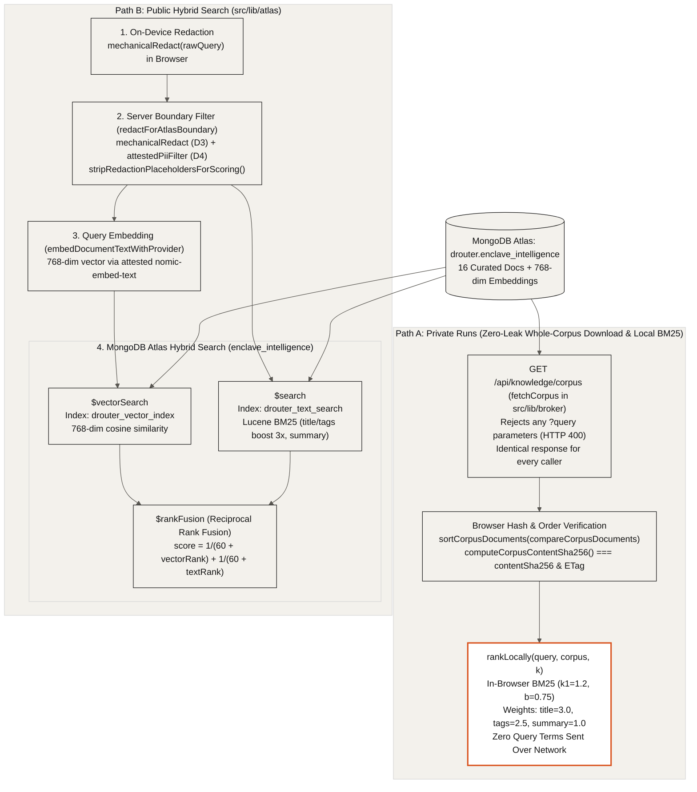

- **Queryless Whole-Corpus Endpoint (`GET /api/knowledge/corpus`)**: `src/app/api/knowledge/corpus/route.ts` rejects any URL containing `?` or search parameters (`HTTP 400`) and serves the full `enclave_intelligence` corpus in canonical UTF-16 code-unit order (`sortCorpusDocuments`) with `Cache-Control: public, max-age=300, s-maxage=3600, stale-while-revalidate=86400` so every caller receives identical bytes.
- **Browser Digest Verification & Local BM25 (`src/lib/broker/index.ts`)**: `fetchCorpus()` validates each document schema, sorts documents via `compareCorpusDocuments()`, recomputes `computeCorpusContentSha256(documents) = sha256(utf8(canonicalJson(sortedDocs)))`, verifies both `contentSha256` and the HTTP `ETag`, and ranks locally in memory with `rankLocally()` (`k1 = 1.2`, `b = 0.75`, field weights `title = 3.0`, `tags = 2.5`, `summary = 1.0`).
- **Dual-Stage Privacy Filter on Public Search (`redactForAtlasBoundary`)**: Before any public search query reaches MongoDB Atlas, `src/lib/atlas/privacy-filter.ts` runs deterministic `mechanicalRedact` (first in the browser and again on the server) followed by the attested `pii-filter` enclave (`attestedPiiFilter`) and strips bracketed placeholders (`stripRedactionPlaceholdersForScoring`) without ever logging or storing raw query text.
- **MongoDB Atlas `$vectorSearch`, `$search`, and `$rankFusion` (`runAtlasHybridSearch`)**: `src/lib/atlas/hybrid-search.ts` embeds the scrubbed query into a 768-dimensional vector (`nomic-embed-text`) and executes native `$vectorSearch` on `drouter_vector_index` (cosine similarity, 64 candidates) alongside `$search` on `drouter_text_search` (`lucene.standard`), combining both pipelines via MongoDB 8.0 `$rankFusion` (`score = 1 / (60 + vectorRank) + 1 / (60 + textRank)`).

## Related documents

- [Google Cloud Confidential Space plan for deroute-core](confidential-space.md) (built and reviewed, not deployed yet)
- [Transparency log restart, 25 October 2026](transparency-log-restart.md)
- [Project README](../README.md)
