## System Overview (`01-overview`)

deRoute splits confidential AI execution across the user's browser, an oblivious Next.js relay on Vercel, hardware-attested Tinfoil enclaves, a content-free Gemini control-plane planner, MongoDB Atlas, and the Circle Arc Testnet registry. Personal text is filtered and encrypted on the device before transmission, while public coordination, knowledge retrieval, and hourly enclave audits leave verifiable cryptographic proofs.

```mermaid
%%{init: {"theme":"base","themeVariables":{"primaryColor":"#f3f1ec","primaryTextColor":"#151515","primaryBorderColor":"#151515","lineColor":"#595752","secondaryColor":"#ffffff","tertiaryColor":"#f3f1ec","fontFamily":"Georgia, serif"}}}%%
flowchart TB
  subgraph Client["User Device"]
    Browser["Browser<br/>On-Device Filter (D3), Symmetry Masking,<br/>C1-C7 Verifier, HPKE Client, Blind Credits"]
  end

  subgraph Vercel["Vercel Next.js App & Oblivious Relay"]
    Relay["Oblivious Relay (/api/relay/v1/*, /api/relay/[relayId]/v1/*)<br/>Adds TINFOIL_API_KEY, Spends x-drouter-credit, Paces Frames"]
    AttestRoutes["Attestation & Matrix Routes<br/>(/api/relay/attestation, /api/relay/enclave-matrix)"]
    PlanRoute["Planner Route (POST /api/gemini/plan)<br/>Closed-Schema Gate + Egress Receipt Signer"]
    CorpusRoute["Corpus & Search Routes<br/>(GET /api/knowledge/corpus, /api/atlas/*)"]
    CronRoute["Hourly Monitor & Registry Routes<br/>(/api/cron/monitor, /api/registry, /api/anchor)"]
  end

  subgraph Tinfoil["Tinfoil Confidential Enclaves"]
    RouterEnclave["Tinfoil Router Enclave (router-0.tinfoil.sh)<br/>AMD SEV-SNP + ATC Attestation"]
    PiiEnclave["Tinfoil pii-filter Enclave<br/>Attested Second-Pass Redaction (D4)"]
    ModelEnclaves["Tinfoil Model Enclaves<br/>(kimi-k3, glm-5-3, deepseek-v4-1-flash,<br/>gpt-oss-120b, llama3-3-70b, gemma4-31b, nomic-embed-text)"]
  end

  subgraph GCP["Google Cloud Confidential Space (built, not yet deployed)"]
    DerouteCore["deroute-core Confidential VM (port 8443)<br/>built, not yet deployed<br/>(/knowledge/corpus, /agent/plan, /transparency/sign-tree-head)"]
  end

  subgraph External["External Control Plane, Storage, Ledger & Scheduler"]
    Gemini["Google Gemini Control Plane (gemini-4-argon)<br/>Content-Free Planner (~67-bit TaskDescriptor)"]
    Atlas["MongoDB Atlas (drouter)<br/>enclave_intelligence (768-dim Vector + BM25 $rankFusion),<br/>agent_verification_receipts, credit_nullifiers"]
    Arc["Circle Arc Testnet Registry (chainId 5042002)<br/>Node Admissions, Stake, Verification & Receipt Anchors"]
    GHActions["GitHub Actions Hourly Monitor<br/>(.github/workflows/monitor.yml: cron 17,47 * * * *)"]
  end

  Browser -->|"RFC 9180 HPKE Ciphertext + x-drouter-credit"| Relay
  Browser -->|"Verify Enclave Bundle & Matrix"| AttestRoutes
  Browser -->|"Content-Free TaskDescriptor"| PlanRoute
  Browser -->|"GET Whole Public Corpus (zero query params)"| CorpusRoute
  Browser -->|"Read Anchor Receipt (eth_getTransactionReceipt)"| Arc

  Relay -->|"HPKE Ciphertext + Bearer TINFOIL_API_KEY"| RouterEnclave
  Relay -->|"HPKE Second-Pass Redaction"| PiiEnclave
  RouterEnclave -->|"Verified Backend Routing"| ModelEnclaves
  AttestRoutes -->|"Fetch SEV-SNP / TDX / Sigstore Bundles"| RouterEnclave

  PlanRoute -.->|"Verify-Then-Pin TLS (/api/core/agent/plan)<br/>built, not yet deployed"| DerouteCore
  DerouteCore -.->|"Content-Free createRequest"| Gemini
  PlanRoute -->|"Fallback: Content-Free createRequest"| Gemini

  CorpusRoute -->|"Load Public Corpus / Hybrid RRF Search"| Atlas
  Relay -->|"Atomic Spend (credit_nullifiers) & Byte Counts"| Atlas
  PlanRoute -->|"Append Merkle Transparency Log Event"| Atlas

  GHActions -->|"POST /api/cron/monitor (Bearer CRON_SECRET)"| CronRoute
  CronRoute -->|"Re-verify Enclaves"| RouterEnclave
  CronRoute -->|"recordVerification & anchorReceipt"| Arc
  CronRoute -->|"Store Coarsened Verification Run"| Atlas

  style Browser stroke:#d9531e,stroke-width:2.5px,fill:#ffffff,color:#151515
  style DerouteCore stroke:#595752,stroke-width:2px,stroke-dasharray: 6 4,fill:#f3f1ec,color:#151515
  style GCP stroke:#595752,stroke-width:1.5px,stroke-dasharray: 6 4,fill:#f3f1ec,color:#151515
```

- **Oblivious Relay and Enclave Routing (`src/lib/relay.ts`, `src/app/api/relay/**`)**: The browser verifies Tinfoil's AMD SEV-SNP router (`router-0.tinfoil.sh`) and model enclaves (`kimi-k3`, `glm-5-3`, `deepseek-v4-1-flash`, `gpt-oss-120b`, `llama3-3-70b`, `gemma4-31b`, `nomic-embed-text`, and `pii-filter`), pads JSON payloads to power-of-two byte buckets, and seals requests with RFC 9180 HPKE (`ehbp-encapsulated-key`). The Next.js relay validates the target origin (`*.tinfoil.sh`, `*.tinfoil.dev`), spends optional `x-drouter-credit` blind tokens, injects `Bearer ${TINFOIL_API_KEY}`, paces response streams, and logs only encrypted byte counts.
- **Content-Free Gemini Planner (`src/app/api/gemini/plan/route.ts`)**: `POST /api/gemini/plan` rejects query parameters, validates the incoming `TaskDescriptor` against a closed schema (`assertGoogleBoundMessage` and `assertContentFree`), and routes planning to `deroute-core` when available or directly to `gemini-4-argon` on the Next.js server when `GEMINI_API_KEY` is configured, returning a signed `GeminiEgressReceipt` with a Merkle transparency log inclusion proof.
- **Google Cloud Confidential Space Workload (`docs/confidential-space.md`)**: `deroute-core` (drawn dashed as built, not yet deployed) is designed to run inside a hardware-isolated Google Cloud Confidential Space VM on port `8443` with in-memory `egress-signing` and `tree-signing` Ed25519 keys bound to the PKI attestation token `eat_nonce` and reached via verify-then-pin TLS from `/api/core/[...path]`.
- **MongoDB Atlas Knowledge Base and Telemetry (`src/lib/atlas/**`, `src/app/api/knowledge/corpus/route.ts`)**: `GET /api/knowledge/corpus` serves the identical sorted 16-document public corpus with a `contentSha256` ETag and zero query parameters so browsers can rank documents locally without leaking topic interest, while `runAtlasHybridSearch` combines 768-dimensional `$vectorSearch`, Lucene `$search`, and MongoDB 8.0 `$rankFusion` over D3/D4-redacted queries.
- **Circle Arc Testnet Registry and Hourly Monitor (`src/lib/arc/**`, `.github/workflows/monitor.yml`)**: GitHub Actions triggers `POST /api/cron/monitor` twice per hour (`17 * * * *` and `47 * * * *`) to re-verify live Tinfoil enclaves and anchor verification records (`recordVerification`, `anchorReceipt`) on the Circle Arc Testnet contract (`chainId 5042002`).
