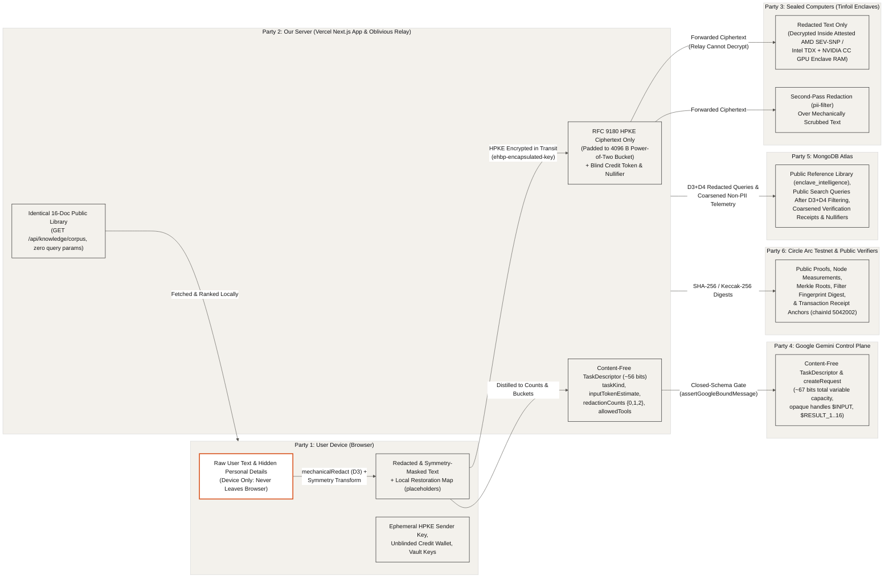

## Trust Boundaries by Party (`02-trust-boundaries`)

Only your device ever sees what you actually typed. Raw user text stays exclusively on the user's device, redacted prompts travel only inside end-to-end HPKE ciphertext to hardware-attested enclaves, and external services (our Next.js server, Google Gemini, MongoDB Atlas, and the Circle Arc blockchain) receive only content-free descriptors, filtered public search terms, or public hash anchors.

- **Device-Only Plaintext (`src/components/console/send-pipeline.ts`, `src/lib/privacy/mechanical.ts`)**: Raw user text, custom scrub terms from the WebAuthn/PBKDF2 vault, placeholder restoration maps (`[EMAIL_1]`, `[SECRET_1]`), and symmetry shift factors remain in browser memory and never cross a network socket.
- **Redacted Text Encrypted in Transit to Sealed Computers (`src/lib/tinfoil/client.ts`, `src/lib/relay.ts`)**: Before leaving the browser, scrubbed text is padded to a power-of-two byte bucket (`padJsonPayloadToBucket`) and encrypted via RFC 9180 HPKE (`ehbp-encapsulated-key`) to the enclave's attested public key so only the Tinfoil enclave (`pii-filter` or model enclave) can decrypt the redacted prompt.
- **Content-Free Control Plane (`src/app/api/gemini/plan/route.ts`, `src/lib/gemini/egress-schemas.ts`)**: Both our Next.js server and Google Gemini (`gemini-4-argon`) receive only the closed-schema `TaskDescriptor` and `createRequest` containing enum values, power-of-two token buckets, coarse redaction counts (`{0, 1, 2}`), and opaque handles (`$INPUT`, `$RESULT_1..16`), validated by `assertGoogleBoundMessage` and `assertContentFree`.
- **Public Library and Filtered Queries on MongoDB Atlas (`src/app/api/knowledge/corpus/route.ts`, `src/lib/atlas/**`)**: Agent runs download the entire 16-document public reference library (`GET /api/knowledge/corpus` with zero query parameters) to rank in browser memory, while direct Atlas hybrid search (`runAtlasHybridSearch`) runs `redactForAtlasBoundary` (D3 + D4) before any query touches `$vectorSearch` or `$search` and forbids storing user text fields (`assertNoUserTextFields`).
- **Public Proofs and Anchors on Circle Arc Testnet (`src/lib/arc/**`, `src/lib/privacy/fingerprint.ts`)**: Only 32-byte cryptographic hashes (enclave measurements, Merkle transparency roots, forensic receipt digests, and the published filter ruleset fingerprint) are anchored on Circle Arc Testnet (`chainId 5042002`).

| Party | What This Party Can See | What This Party Cannot See | Enforcement Mechanism |
| :--- | :--- | :--- | :--- |
| **User Device (Browser)** | Raw user text, redacted text, placeholder restoration table, symmetry parameters, unblinded credits, and all verification receipts. | Operator secrets (`TINFOIL_API_KEY`, `GEMINI_API_KEY`, `MONGODB_URI`, `ARC_VERIFIER_PRIVATE_KEY`). | Client-side execution in browser memory (`src/components/console/send-pipeline.ts`, `src/lib/agent-client/index.ts`). |
| **Sealed Computers (Tinfoil Enclaves)** | Redacted and symmetry-masked text (decrypted inside hardware-encrypted enclave RAM), padded to a power-of-two byte bucket. | Original unredacted names, emails, secrets, or user IP addresses (hidden behind the Vercel relay). | On-device `mechanicalRedact` (D3), symmetry masking, RFC 9180 HPKE (`ehbp-encapsulated-key`), and AMD SEV-SNP / Intel TDX attestation. |
| **Our Server (Vercel Next.js App & Relay)** | HPKE ciphertext byte length (bucketed), blind credit token and nullifier, and the content-free `TaskDescriptor` (`~56 bits`). | Raw user text, redacted prompt text, model completions, or linkable payment identity. | End-to-end HPKE to enclave key (`src/lib/relay.ts`), Chaumian RSA blind signatures (`src/lib/credits/blind.ts`), and closed schema validation. |
| **Google Gemini (`gemini-4-argon`)** | Content-free `TaskDescriptor` and `createRequest` (`~67 bits` total variable information) over opaque handles (`$INPUT`, `$RESULT_1..16`). | Raw user text, redacted prompt text, enclave outputs, or full SHA-256 digests (`> 16` hex chars). | Dual fail-closed egress gates (`assertGoogleBoundMessage` and `assertContentFree` in `src/lib/gemini/egress-schemas.ts`). |
| **MongoDB Atlas** | 16-document public reference library, public search queries after D3+D4 redaction, coarsened UTC-hour verification receipts, and credit nullifiers. | Raw user prompts, unscrubbed search queries, exact request timestamps, or payer wallet addresses. | Whole-corpus fetch (`GET /api/knowledge/corpus`), `redactForAtlasBoundary`, `assertNoUserTextFields`, and `coarsenIsoToUtcHour`. |
| **Circle Arc Testnet (Public)** | Registered enclave node IDs, hardware measurement hashes, published filter fingerprint anchor, and 32-byte receipt digests. | Any prompt text, descriptor fields, or private keys. | 32-byte hash arguments in `recordVerification` and `anchorReceipt` (`src/lib/arc/registry.ts`). |
