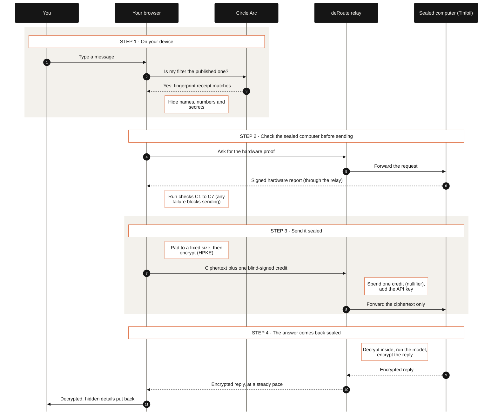

## Confidential Chat Lifecycle (`03-chat-lifecycle`)

When a user sends a chat message, the browser first verifies that its local personal-detail filter matches the published ruleset anchored on Circle Arc Testnet and scrubs sensitive terms on the device. It then verifies all seven enclave checks (`C1` through `C7`), pads and HPKE-encrypts the scrubbed prompt to the enclave's attested public key, attaches an unlinkable blind-signed credit token for the relay, and restores the hidden details locally after decrypting the enclave's reply.

- **On-Device Filter and Fingerprint Gate (`src/components/privacy/filter-fingerprint-badge.tsx`, `src/components/console/send-pipeline.ts`)**: Before any message is prepared, `assertFilterFingerprintAllowsSend()` recomputes the SHA-256 digest of `MECHANICAL_RULESET` in the browser and compares it against `published-fingerprint.json` (whose anchor transaction is verified on Circle Arc Testnet via `eth_getTransactionReceipt`); any mismatch throws `FilterFingerprintMismatchError` and blocks sending.
- **Client-Side Redaction and Padding (`src/components/console/send-pipeline.ts`, `src/lib/relay.ts`)**: `prepareOutboundTurn()` loads active custom scrub terms from the unlocked local vault, runs `preparePrompt()` to replace PII and secrets with numbered placeholders (`[EMAIL_1]`, `[SECRET_1]`), and pads the outbound JSON payload with RFC 8259 trailing spaces to a power-of-two byte bucket (`padJsonPayloadToBucket`, minimum `4096` bytes) immediately prior to HPKE sealing.
- **Browser-Verified Seven Checks (`src/lib/tinfoil/client.ts`)**: `openTinfoilSession()` verifies the enclave attestation bundle and deep matrix in the browser across `C1` (`Hardware signature chain`), `C2` (`Approved software`), `C3` (`HPKE key bound to enclave report`), `C4` (`Running code = released code`), `C5` (`Router-attested confidential GPU pool`), `C6` (`Registry admission`), and `C7` (`Manifest-pinned model & dm-verity root`) before sealing the request with an ephemeral RFC 9180 HPKE sender key (`ehbp-encapsulated-key`).
- **Blind-Signed Credit Spend and Oblivious Relay (`src/lib/credits/**`, `src/app/api/relay/v1/[...path]/route.ts`)**: If the browser attaches an unblinded Chaumian RSA credit token in `x-drouter-credit`, the relay verifies its signature against the denomination's coprime exponent (`65537`, `65539`, or `65543` over a Full-Domain Hash in `Z_n^*`), atomically inserts `sha256("drouter/v1/credit-nullifier:" + token)` into `credit_nullifiers` to prevent double-spending, raises the ciphertext body cap to `512 KB`, and adds `Authorization: Bearer ${TINFOIL_API_KEY}` without ever seeing plaintext.
- **Cadence-Paced Encrypted Stream and Local Restoration (`src/lib/relay.ts`, `src/components/console/send-pipeline.ts`)**: The enclave returns an HPKE-encrypted stream (`ehbp-response-nonce`) which the relay flushes on a fixed interval (`pacedStream`, `50 ms`) and the browser decrypts and passes through `prepared.restore()` so original names and identifiers reappear only on the user's screen.
