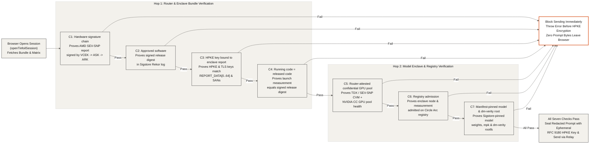

## Seven Pre-Send Verification Checks (`04-seven-checks`)

Before the browser encrypts or transmits a single prompt byte, it evaluates a seven-step verification checklist (`C1` through `C7`) against the live enclave attestation bundle, the Sigstore transparency log, the deep model enclave matrix, and the Circle Arc registry. If any check fails, the client aborts session setup immediately so no message can be sent to an unverified computer.

- **Hardware Root and Provenance (`C1: Hardware signature chain`, `C2: Approved software`)**: In `checksFromDocument()` (`src/lib/tinfoil/client.ts`), `C1` verifies the AMD SEV-SNP hardware attestation report all the way to AMD's root certificate chain (`VCEK -> ASK -> ARK`, ECDSA-P384 + RSASSA-PSS), while `C2` confirms that the enclave release digest (`tinfoil.hash`) is signed and recorded in the Sigstore Rekor transparency log.
- **Cryptographic Key Binding and Measurement Equality (`C3: HPKE key bound to enclave report`, `C4: Running code = released code`)**: `C3` proves that the enclave's RFC 9180 HPKE public key and TLS certificate fingerprint match `REPORT_DATA[0..64]` inside the hardware report, and `C4` confirms that the CPU's launch measurement register equals the measurement published in the signed release predicate.
- **Confidential GPU Pool and Pinned Weights (`C5: Router-attested confidential GPU pool`, `C7: Manifest-pinned model & dm-verity root`)**: Using `verifyModelEnclaveStatus()` (`src/lib/tinfoil/deep-inspect.ts`), `C5` verifies that the target model enclave pool runs on attested Intel TDX or AMD SEV-SNP confidential VMs with NVIDIA Confidential Computing GPU flags enabled, and `C7` verifies that the Sigstore DSSE predicate pins the exact Hugging Face weight commit, `mpk` package hash, and read-only `dm-verity` root filesystem hash.
- **On-Chain Admission and Fail-Closed Blocking (`C6: Registry admission`)**: `C6` checks the enclave node ID and measurement against the Circle Arc Testnet registry (`0xbc8085c2b6fe6e0db05f169925c0b841828f4481`), and any failure across `C1` through `C7` causes `openTinfoilSession()` (or the agent sandbox evaluator) to reject the target enclave before any prompt ciphertext is sealed or sent.
