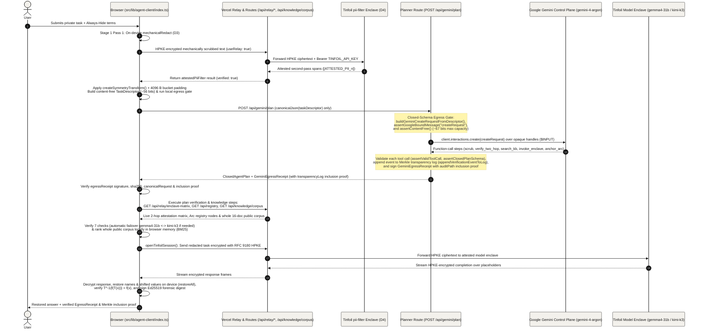

## Split-Knowledge Agent Lifecycle (`05-agent-lifecycle`)

The autonomous agent workflow in `src/lib/agent-client/index.ts` separates control-plane planning from confidential data execution so Google Gemini never sees user text or redacted text. The browser runs on-device mechanical redaction followed by an attested second pass through the `pii-filter` enclave, sends only a content-free `TaskDescriptor` to `POST /api/gemini/plan`, executes the returned plan steps in the browser (fetching the whole public corpus and sending the redacted task over HPKE to the model enclave), restores names on the device, and verifies the signed egress receipt with its Merkle inclusion proof.

- **Two-Pass Redaction and Symmetry Masking (`runBrowserRedactionPipeline`)**: Stage 1 runs `mechanicalRedact` (D3) on the device first, sends the mechanically scrubbed text over HPKE through `/api/relay` to Tinfoil's attested `pii-filter` enclave (`attestedPiiFilter`, D4) for a second pass (`[ATTESTED_PII_n]`), applies reversible date/numeric/entity symmetry masking (`createSymmetryTransform`), and aligns the payload to a `4096`-byte power-of-two bucket.
- **Content-Free `TaskDescriptor` and Closed-Schema Egress Gate (`requestAgentPlanFromBrowser`, `src/app/api/gemini/plan/route.ts`)**: The browser distills the task into a content-free `TaskDescriptor` (`taskKind`, power-of-two `inputTokenEstimate`, bucketed `redactionCounts`, `verification` booleans, and `allowedTools`), verifies it locally with `assertOutboundPrivacyInvariant`, `assertGoogleBoundMessage("taskDescriptor")`, and `assertContentFree`, and posts only that descriptor to `POST /api/gemini/plan`, which re-verifies the closed schema before calling `gemini-4-argon` (`client.interactions.create`).
- **In-Browser Step Execution and Whole-Corpus Ranking (`runBrowserAgentWorkflow`)**: After validating the returned `ClosedAgentPlan` (`assertClosedPlanSchema`), the browser executes the verification and knowledge steps locally by fetching `/api/relay/enclave-matrix`, `/api/registry`, and the entire 16-document public knowledge corpus (`GET /api/knowledge/corpus` with zero query parameters, ranked in browser memory via `fetchWholeCorpusAndRankInBrowser`).
- **Direct Browser-to-Enclave HPKE Execution and Homomorphic Restoration (`openTinfoilSession`, `restoreAll`)**: The browser evaluates the target model enclave (`gemma4-31b` or `kimi-k3`, with automatic failover if hardware checks fail), sends the redacted prompt directly to the attested Tinfoil enclave over RFC 9180 HPKE, and runs `restoreAll()` and `verifyRedactionAndSymmetryRestore()` on the device to confirm $T^{-1}(f(T(x))) = f(x)$.
- **Signed Egress Receipt with Merkle Inclusion Proof (`verifyEgressReceiptClient`, `appendVerificationEventToLog`)**: `POST /api/gemini/plan` records the request SHA-256 in the append-only Merkle transparency log and returns a `GeminiEgressReceipt` containing the exact `canonicalRequest`, `sha256`, signer public key, and `transparencyLog` inclusion proof (`leafIndex`, `leafHash`, `treeSize`, `rootHash`, `auditPath`, `treeHeadSignature`), which the browser cryptographically verifies alongside its own Ed25519-signed Stage 6 forensic proof digest.
