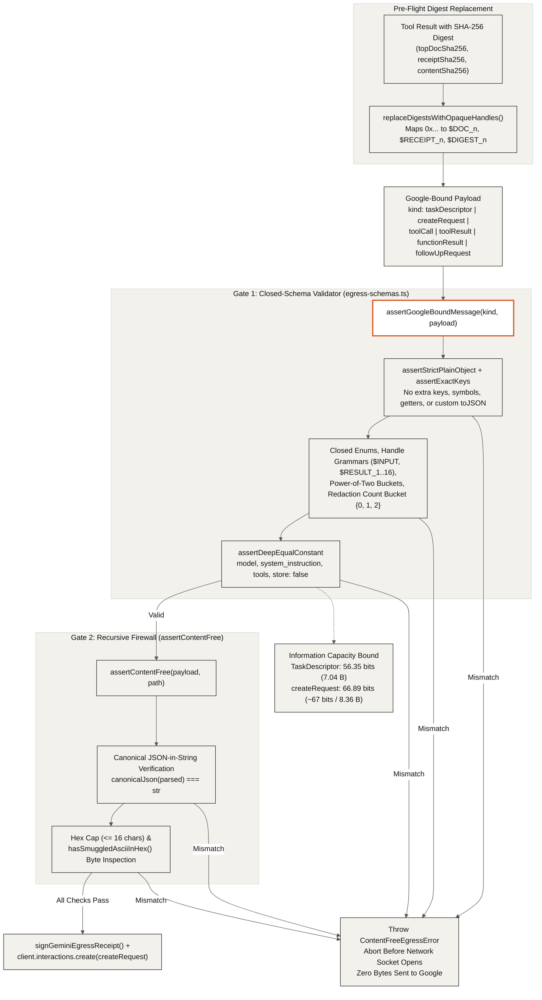

## Outbound Egress Gate (`06-egress-gate`)

Every message bound for Google Gemini must pass two independent, fail-closed validators before any network request is opened. Even if an attacker controls the input values, the closed schema restricts a `createRequest` payload to about 67 bits (8.36 bytes) of total variable information, and any schema or content violation immediately throws an error so nothing leaves the machine.

- **Closed-Schema Primary Gate (`assertGoogleBoundMessage`)**: Defined in `src/lib/gemini/egress-schemas.ts` (and mirrored in `core/src/firewall.js`), this validator dispatches on the exact message `kind` (`taskDescriptor`, `interactionsPayload`, `createRequest`, `toolCall`, `toolResult`, `functionResult`, `followUpRequest`) and enforces exact key sets, plain object prototypes, power-of-two integer buckets (`inputTokenEstimate`, `outputTokenEstimate`, `bucketQuantumBytes`, `bucketBytes`, `max_output_tokens`), coarse redaction buckets (`{0, 1, 2}` on `TaskDescriptor`), and deep equality against static constants (`model`, `system_instruction`, `ARGON_CONFIDENTIAL_TOOLS`, `store: false`).
- **Opaque Handle Substitution (`replaceDigestsWithOpaqueHandles`)**: Before any tool result is serialized into a Google-bound request, 64-character SHA-256 hex digests (`topDocSha256`, `receiptSha256`, `contentSha256`, `outputSha256`, `routerDigestHex`, `enclaveMeasurementHex`) are replaced with indexed handles (`$DOC_1..16`, `$RECEIPT_1..16`, `$DIGEST_1..16`, `$ROUTER_1..16`, `$MEASUREMENT_1..16`), keeping the raw hashes in server memory only.
- **Defense-in-Depth Recursive Firewall (`assertContentFree`)**: Runs immediately after `assertGoogleBoundMessage` to recursively inspect every key, primitive, array, and JSON-encoded string (`canonicalJson(parsed) === str`), enforcing `MAX_GOOGLE_BOUND_HEX_LENGTH = 16` and scanning any short hex bytes with `hasSmuggledAsciiInHex()`.
- **Information Capacity Bound (~67 Bits)**: Across all variable fields of a `createRequest` or `InteractionsCreatePayload` (`TaskDescriptor` at 56.35 bits, `thinking_level`, `background`, `max_output_tokens`, and canonical subsets of the 5 planner tools), the total combinatorial cardinality is $1.37 \times 10^{20}$, capping the maximum encodeable information at 66.89 bits (8.36 bytes) per request.
- **Fail-Closed Abort (`ContentFreeEgressError`)**: Any mismatch in either gate throws `ContentFreeEgressError` before `client.interactions.create` is invoked, guaranteeing that zero bytes are transmitted when an invariant fails.
