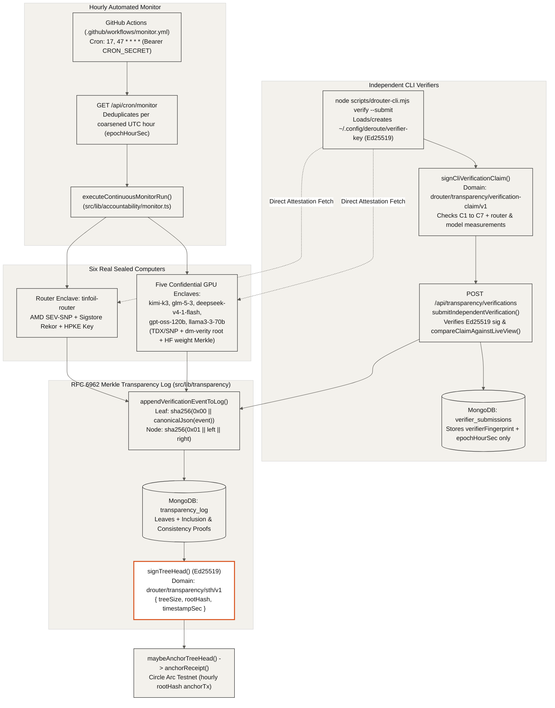

## Continuous Enclave Verification & RFC 6962 Transparency Log (`07-verification`)

An hourly GitHub Actions monitor and independent command-line verifiers continuously check the hardware attestation, software release signatures, and model weight roots of all six real sealed computers. Every verification result is appended as a leaf to an RFC 6962 Merkle transparency log whose signed tree head is anchored on Circle Arc once per UTC hour.

- **Hourly Monitor Across Six Sealed Computers**: `.github/workflows/monitor.yml` triggers `GET /api/cron/monitor` (`src/app/api/cron/monitor/route.ts`) with constant-time `CRON_SECRET` authentication at minutes `:17` and `:47`, deduplicating by `coarsenEpochSecToHour()` and executing `executeContinuousMonitorRun()` across `tinfoil-router` and the five model enclaves (`kimi-k3`, `glm-5-3`, `deepseek-v4-1-flash`, `gpt-oss-120b`, `llama3-3-70b`).
- **RFC 6962 Merkle Tree Construction**: `src/lib/transparency/log.ts` hashes each canonical event leaf with `sha256(0x00 || utf8(canonicalJson(entry)))` and internal nodes with `sha256(0x01 || left || right)`, producing client-verifiable inclusion proofs (`computeAuditPathFromLeaves`) and consistency proofs (`proveConsistencyFromLeaves`).
- **Signed Tree Head & Circle Arc Anchoring**: After appending leaves to `transparency_log`, `signTreeHead()` signs `{ domain: "drouter/transparency/sth/v1", rootHash, timestampSec, treeSize }` with the operator Ed25519 key, and `maybeAnchorTreeHead()` anchors `rootHash` on Circle Arc via `anchorReceipt()` at most once per hour.
- **Independent Verifier Claims (`drouter-cli.mjs verify --submit`)**: Anyone can run `node scripts/drouter-cli.mjs verify --submit` to verify the live router and model enclaves directly, sign a canonical C1 to C7 claim (`drouter/transparency/verification-claim/v1`) with their local Ed25519 key (`~/.config/deroute/verifier-key`), and submit it to `POST /api/transparency/verifications`.
- **Zero-Metadata Verifier Storage**: `submitIndependentVerification()` (`src/lib/transparency/store.ts`) verifies the Ed25519 signature, checks every claimed measurement against `getLiveVerificationView()`, records only `verifierFingerprint` (SHA-256 of the public key) and coarsened `epochHourSec` in `verifier_submissions`, and appends the verified claim to the transparency log.
