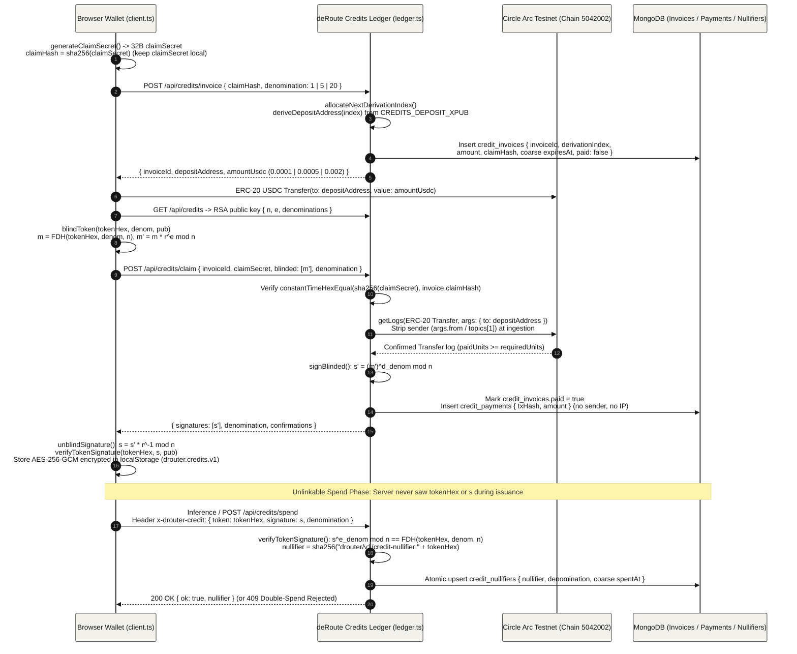

## Anonymous Deposit Invoices & RSA Blind-Signed Credits (`08-payments`)

To pay for enclave inference without linking a wallet address to any prompt or session, the browser requests a one-time deposit address using only the SHA-256 hash of a local secret, deposits fixed-denomination USDC on Circle Arc, and claims RSA blind-signed credit tokens. When the browser later spends an unblinded token, the server verifies the RSA signature and records a SHA-256 nullifier, making the spend mathematically unlinkable to the invoice or on-chain payment.

- **Watch-Only BIP32 Deposit Derivation (`deriveDepositAddress`)**: `src/lib/credits/ledger.ts` derives a fresh child address on Circle Arc Testnet (`chainId: 5042002`) from the public `CREDITS_DEPOSIT_XPUB` (`m/44'/60'/0'/0/<derivationIndex>`) while keeping the spending private key offline, and enforces fixed USDC denominations (`0.0001`, `0.0005`, or `0.002` USDC for `1`, `5`, or `20` credits) to prevent amount fingerprinting.
- **Hash-Committed Claim Secret & Sender Stripping**: The browser sends only `claimHash = sha256(claimSecret)` to `POST /api/credits/invoice` (which rejects requests containing `claimSecret` or payer addresses). On `POST /api/credits/claim`, `getUsdcTransferLogs()` queries ERC-20 `Transfer(to: depositAddress)` events on `0x3600000000000000000000000000000000000000` and strips `args.from` and `topics[1]` at ingestion so payer wallet addresses never enter memory or `credit_payments`.
- **Denomination-Bound RSA Full-Domain-Hash Blind Signatures**: `src/lib/credits/blind.ts` maps each random `tokenHex` and denomination into $\mathbb{Z}_n^*$ via HKDF-SHA-256 (`hashTokenMessage`) and uses distinct coprime public exponents per denomination (`1 -> 65537`, `5 -> 65539`, `20 -> 65543`) so a low-denomination signature cannot be forged into a high-denomination credit.
- **Encrypted Local Wallet Storage**: After unblinding `s = s' \cdot r^{-1} \bmod n` and verifying `verifyTokenSignature(creditToken, pub)` locally, `src/lib/credits/client.ts` encrypts the unspent tokens in `localStorage` (`drouter.credits.v1`) with AES-256-GCM under the active vault session key (or an ephemeral in-memory CSPRNG key) and AAD `drouter/v1/credits-wallet`.
- **Nullifier Double-Spend Protection**: When a credit is spent via `x-drouter-credit` or `POST /api/credits/spend`, the server verifies $s^{e_{\text{denom}}} \bmod n = \text{FDH}(\text{tokenHex}, \text{denom}, n)$ and atomically inserts `nullifier = sha256("drouter/v1/credit-nullifier:" + tokenHex)` into `credit_nullifiers` with a coarsened UTC-hour `spentAt` timestamp.
