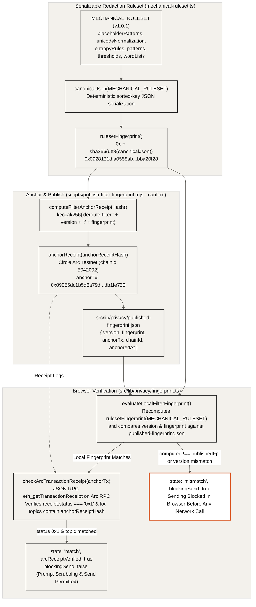

## On-Device Filter Fingerprint & Circle Arc Verification (`09-filter-fingerprint`)

All regular expressions, Unicode homoglyph tables, entropy thresholds, and allowlists for the on-device personal-detail filter live in a single serializable object (`MECHANICAL_RULESET`) whose canonical SHA-256 fingerprint is anchored on Circle Arc. Before sending any prompt, the browser recomputes that SHA-256 fingerprint locally, compares it against `published-fingerprint.json` and the Circle Arc transaction receipt log, and blocks sending if the running filter does not match.

- **Canonical Ruleset Serialization (`MECHANICAL_RULESET`)**: `src/lib/privacy/mechanical-ruleset.ts` defines every pattern source, flag, Unicode normalization range, homoglyph map, entropy threshold, and word list in a pure data structure (`version: "1.0.1"`), which `rulesetFingerprint()` (`src/lib/privacy/fingerprint.ts`) hashes as `0x` + `sha256(utf8(canonicalJson(ruleset)))` (`0x0928121dfa0558ab8e59af0298aa76c5b9a3674012d2ff162b66df79bba20f28`).
- **Circle Arc Receipt Anchoring (`publish-filter-fingerprint.mjs`)**: Running `node scripts/publish-filter-fingerprint.mjs --confirm` computes `computeFilterAnchorReceiptHash(version, fingerprint) = keccak256("deroute-filter:" + version + ":" + fingerprint)`, anchors it on Circle Arc (`chainId: 5042002`) via `anchorReceipt()`, waits for receipt confirmation, and writes `{ version, fingerprint, anchorTx, chainId, anchoredAt }` to `src/lib/privacy/published-fingerprint.json` (`anchorTx: 0x09055dc1b5d6a79de9d96824ee76213b2c238a8bfd744ab143405d30db1fe730`).
- **Local Recomputation & Comparison (`evaluateLocalFilterFingerprint`)**: On page load and before sending, the browser recomputes `rulesetFingerprint(MECHANICAL_RULESET)` over the in-memory filter rules and compares both `version` and `computedFingerprint` against `published-fingerprint.json`.
- **Direct On-Chain Receipt Log Verification (`checkArcTransactionReceipt`)**: When the local hash matches, `verifyFilterFingerprint()` issues a read-only `eth_getTransactionReceipt` JSON-RPC call to `ARC_PUBLIC_RPC_URL` (`https://rpc.testnet.arc.network`) and verifies that `receipt.status === "0x1"` and that `receipt.logs` contains a topic matching `computeFilterAnchorReceiptHash(version, computed)`.
- **Fail-Closed Send Blocking (`blockingSend: true`)**: If the browser's computed fingerprint or version diverges from `published-fingerprint.json`, `evaluateLocalFilterFingerprint()` returns `state: "mismatch"` and `blockingSend: true`, preventing any prompt from being sent.
