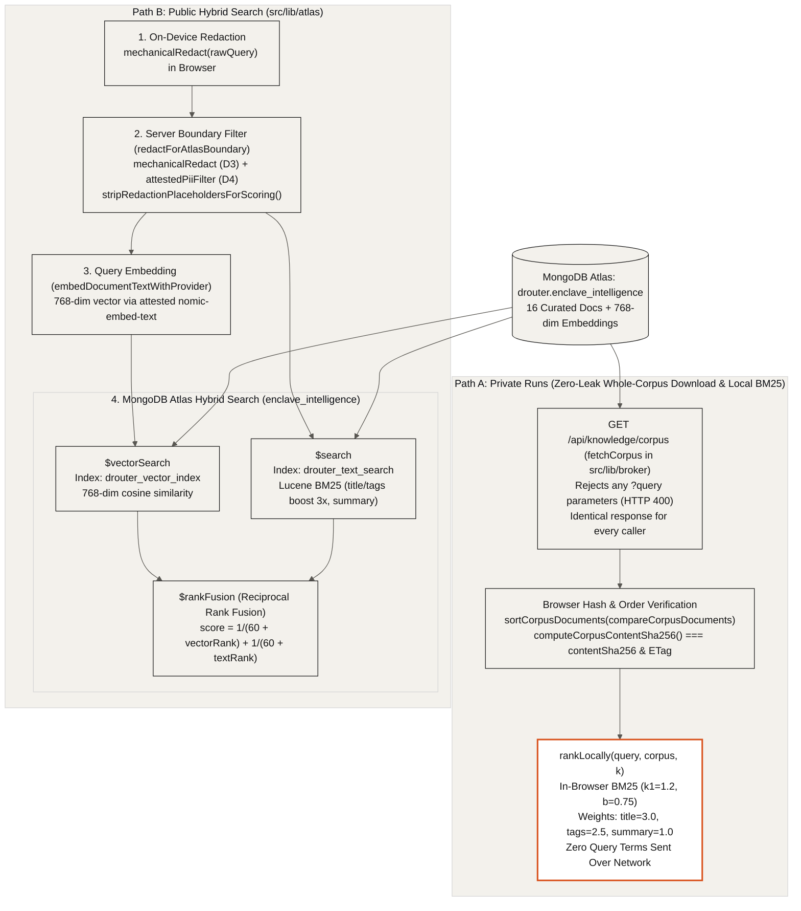

## Split-Path Knowledge Retrieval: Whole-Library BM25 vs. Atlas Hybrid Search (`10-knowledge`)

Private enclave runs never send a search query to the server; instead, the browser downloads the entire public intelligence corpus from `/api/knowledge/corpus`, verifies its canonical SHA-256 digest, and ranks documents locally with BM25. When a user explicitly uses the public hybrid search explorer, the typed text is scrubbed on the device and again on the server before running MongoDB Atlas `$vectorSearch`, `$search`, and `$rankFusion`.

- **Queryless Whole-Corpus Endpoint (`GET /api/knowledge/corpus`)**: `src/app/api/knowledge/corpus/route.ts` rejects any URL containing `?` or search parameters (`HTTP 400`) and serves the full `enclave_intelligence` corpus in canonical UTF-16 code-unit order (`sortCorpusDocuments`) with `Cache-Control: public, max-age=300, s-maxage=3600, stale-while-revalidate=86400` so every caller receives identical bytes.
- **Browser Digest Verification & Local BM25 (`src/lib/broker/index.ts`)**: `fetchCorpus()` validates each document schema, sorts documents via `compareCorpusDocuments()`, recomputes `computeCorpusContentSha256(documents) = sha256(utf8(canonicalJson(sortedDocs)))`, verifies both `contentSha256` and the HTTP `ETag`, and ranks locally in memory with `rankLocally()` (`k1 = 1.2`, `b = 0.75`, field weights `title = 3.0`, `tags = 2.5`, `summary = 1.0`).
- **Dual-Stage Privacy Filter on Public Search (`redactForAtlasBoundary`)**: Before any public search query reaches MongoDB Atlas, `src/lib/atlas/privacy-filter.ts` runs deterministic `mechanicalRedact` (first in the browser and again on the server) followed by the attested `pii-filter` enclave (`attestedPiiFilter`) and strips bracketed placeholders (`stripRedactionPlaceholdersForScoring`) without ever logging or storing raw query text.
- **MongoDB Atlas `$vectorSearch`, `$search`, and `$rankFusion` (`runAtlasHybridSearch`)**: `src/lib/atlas/hybrid-search.ts` embeds the scrubbed query into a 768-dimensional vector (`nomic-embed-text`) and executes native `$vectorSearch` on `drouter_vector_index` (cosine similarity, 64 candidates) alongside `$search` on `drouter_text_search` (`lucene.standard`), combining both pipelines via MongoDB 8.0 `$rankFusion` (`score = 1 / (60 + vectorRank) + 1 / (60 + textRank)`).
